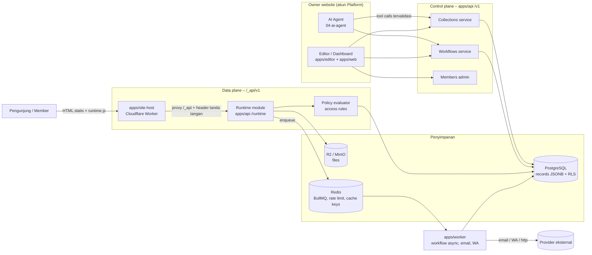
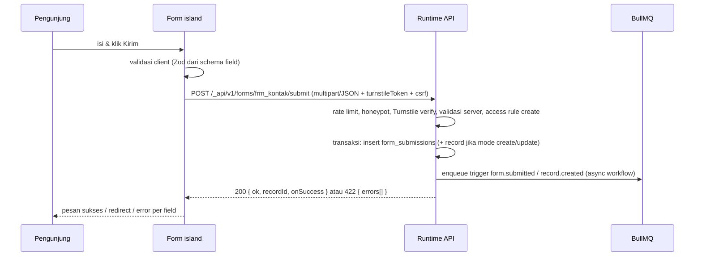
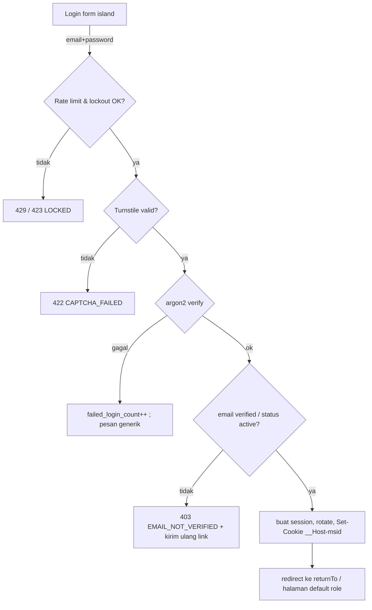

# 05 — Dynamic Data: Collections, Bindings, Forms, End-user Auth, Workflows

> Status: Draft v1 · Fase utama: **M7 – Website dinamis** · Prefix requirement: `DATA-`
>
> Dokumen ini mendefinisikan **perilaku, runtime, penyimpanan, keamanan, dan kuota** fitur website dinamis Platform.
> Format inti node/props/binding di dalam dokumen website **tidak** didefinisikan ulang di sini — rujuk
> [Document Model](./01-document-model.md). Dokumen terkait:
> [Editor](./02-editor.md) · [AI Agent](./04-ai-agent.md) · [Commerce & Payments](./06-commerce-payments.md) ·
> [Publishing & Hosting](./07-publishing-hosting.md) · [Accounts, Plans & Admin](./08-accounts-plans-admin.md) ·
> [Architecture](../ARCHITECTURE.md)

---

## Daftar isi

1. [Ringkasan & prinsip](#1-ringkasan--prinsip)
2. [Konsep & batas sistem](#2-konsep--batas-sistem)
3. [Collections & field](#3-collections--field)
4. [Penyimpanan data](#4-penyimpanan-data)
5. [Data Manager UI](#5-data-manager-ui)
6. [Bindings](#6-bindings)
7. [Forms](#7-forms)
8. [End-user auth (member website)](#8-end-user-auth-member-website)
9. [Access rules & permissions](#9-access-rules--permissions)
10. [Dashboard & table blocks](#10-dashboard--table-blocks)
11. [Workflows](#11-workflows)
12. [Runtime API & islands](#12-runtime-api--islands)
13. [Keamanan menyeluruh](#13-keamanan-menyeluruh)
14. [Kuota per paket](#14-kuota-per-paket)
15. [Peran AI](#15-peran-ai)
16. [Contoh end-to-end](#16-contoh-end-to-end)
17. [Fase & prioritas](#17-fase--prioritas)
18. [Daftar OPEN](#18-daftar-open)

Konvensi requirement:

```
### DATA-NNN Judul
- Prioritas · Fase      (P0 = wajib untuk fase itu, P1 = penting, P2 = nanti)
- Deskripsi / Perilaku
- Acceptance criteria   (checklist yang bisa diuji)
```

Rentang ID per bagian (ada celah untuk tambahan di masa depan):

| Bagian | Rentang ID |
|---|---|
| 2 Konsep | DATA-001 – DATA-009 |
| 3 Collections | DATA-010 – DATA-039 |
| 4 Penyimpanan | DATA-040 – DATA-059 |
| 5 Data Manager UI | DATA-060 – DATA-079 |
| 6 Bindings | DATA-080 – DATA-109 |
| 7 Forms | DATA-110 – DATA-139 |
| 8 End-user auth | DATA-140 – DATA-179 |
| 9 Access rules | DATA-180 – DATA-199 |
| 10 Dashboard & table | DATA-200 – DATA-229 |
| 11 Workflows | DATA-230 – DATA-289 |
| 12 Runtime API & islands | DATA-290 – DATA-319 |
| 13 Keamanan | DATA-320 – DATA-339 |
| 14 Kuota | DATA-340 – DATA-349 |
| 15 Peran AI | DATA-350 – DATA-369 |

---

## 1. Ringkasan & prinsip

Website dinamis memungkinkan website user (UMKM/company) menyimpan data, menampilkan data, menerima input pengunjung,
mempunyai member yang bisa login, dan menjalankan otomasi — **tanpa user menulis kode dan tanpa AI menulis kode bebas**.

Prinsip desain (berlaku untuk seluruh dokumen):

1. **Blok terbatas yang aman.** Semua perilaku dinamis = konfigurasi JSON yang tervalidasi Zod
   (collections, bindings, access rules, workflows). Tidak ada `eval`, tidak ada SQL mentah dari user/AI.
2. **AI mengkonfigurasi, user tetap memegang kendali.** Semua yang dibuat AI terlihat dan bisa diedit secara visual
   (Data Manager, panel Binding, Workflow editor, panel Access). Tidak ada "konfigurasi tersembunyi".
3. **Default aman (deny).** Collection baru tidak bisa dibaca/ditulis publik sampai rule eksplisit dibuat.
4. **Statis dulu, dinamis seperlunya.** Halaman publish tetap HTML statis; hanya node data-bound yang di-hydrate
   oleh *islands* runtime kecil.
5. **Isolasi tenant mutlak.** Setiap query di data plane wajib ber-scope `site_id`; dijaga di level aplikasi DAN
   PostgreSQL Row Level Security (RLS).
6. **Gating paket.** Fitur dinamis hanya untuk paket yang menyertakan AI (lihat [§14](#14-kuota-per-paket) dan
   [08-accounts-plans-admin.md](./08-accounts-plans-admin.md)). Pengecualian terbatas: form kontak sederhana (OPEN, [§7.6](#76-form-kontak-untuk-paket-statis)).
7. **Satu sumber kebenaran.** Konfigurasi dinamis (schema collection, workflow, rule) disimpan di DB platform
   (bukan di dokumen Yjs), sedangkan *binding* disimpan di document model karena melekat pada node.

---

## 2. Konsep & batas sistem

### 2.1 Glosarium

| Konsep | Definisi | Disimpan di |
|---|---|---|
| **Site** | Satu website user. Unit isolasi tenant (`site_id`). | DB platform |
| **Collection** | "Tabel" milik site: nama, slug, daftar field bertipe, display field, index, access rules. | `collections` |
| **Field** | Kolom collection dengan tipe, validasi, default. | `collections.schema` (JSONB) |
| **Record** | Satu baris data di collection. | `records` (generik, JSONB) |
| **Binding** | Hubungan node ↔ data: repeater, field mapping, detail page, conditional visibility, form mapping. | Document model (node props) — lihat [01](./01-document-model.md) |
| **Form** | Node form + field nodes yang mengirim data ke collection dan/atau workflow. | Document model + `form_submissions` |
| **Member** | End-user website (pengunjung yang register/login di website user). **Terpisah** dari akun Platform. | `members` |
| **Role** | Peran member per site (`admin`, `member`, custom). | `site_roles` |
| **Access rule** | Aturan siapa boleh read/create/update/delete per collection (dan field). | `collections.access` (JSONB) |
| **Workflow** | Trigger → steps yang dijalankan workflow engine. | `workflows`, `workflow_versions`, `workflow_runs` |
| **Runtime API** | Data plane HTTP yang dipanggil website publish (islands). | `apps/api` (modul `runtime`) via `apps/site-host` |
| **Island** | Potongan JS di halaman publish yang hydrate node data-bound. | Bundle `runtime.js` di R2/edge |

### 2.2 Control plane vs data plane

- **Control plane** — dipakai owner website di dashboard/editor (`app.platformmu.com`): CRUD schema collection,
  Data Manager, workflow editor, member management. Auth = akun Platform (Better Auth). API: `apps/api` path
  `/v1/sites/:siteId/...`.
- **Data plane** — dipakai pengunjung website publish (`tokobudi.platformmu.site` / custom domain; root domain situs dari env `SITES_ROOT_DOMAIN`): baca list,
  submit form, login member, CRUD sesuai access rule. Auth = session member per site. API: `https://<site-host>/_api/v1/...`
  (keputusan di [§12.1](#121-keputusan-url-runtime-api)).

Kedua plane memakai service layer yang sama (`records.service.ts`, `workflows.service.ts`) tetapi **policy
evaluator** berbeda: control plane = owner/editor site (full access), data plane = access rules.

### 2.3 Diagram alur tingkat tinggi



### 2.4 Alur request data plane (list publik)

```mermaid
sequenceDiagram
  participant B as Browser (runtime.js)
  participant W as site-host (Worker)
  participant C as Edge cache
  participant A as apps/api runtime
  participant P as PostgreSQL
  B->>W: GET /_api/v1/collections/produk/records?filter...
  W->>W: resolve host -> siteId, cek paket dinamis aktif
  W->>C: lookup cache key (siteId, query, dataVersion)
  alt hit
    C-->>B: 200 JSON (cache)
  else miss
    W->>A: forward ke /runtime/v1/... + X-Site-Token (HMAC)
    A->>A: verify signature, load collection + access rule
    A->>P: SET app.site_id; SELECT ... WHERE site_id AND rule
    P-->>A: rows
    A-->>W: 200 JSON + Cache-Control (public read saja)
    W->>C: simpan
    W-->>B: 200 JSON
  end
```

### DATA-001 Pemisahan control plane dan data plane
- **Prioritas:** P0 · **Fase:** M7
- **Deskripsi / Perilaku:** Endpoint control plane (`/v1/sites/:siteId/collections`, dst.) hanya menerima session akun
  Platform dengan hak atas site. Endpoint data plane (`/_api/v1/...`) hanya menerima request yang diteruskan oleh
  `apps/site-host` dengan header `X-Site-Token` (HMAC-SHA256 atas `siteId.deploymentId.timestamp.method.path` dengan
  `SITE_HOST_SIGNING_SECRET`, toleransi ±60 detik; lihat [ARCHITECTURE §9.3](../ARCHITECTURE.md#93-service-to-service)). `siteId` hanya diambil dari token ini. Data plane tidak pernah menerima cookie akun Platform.
- **Acceptance criteria:**
  - [ ] Request langsung ke `apps/api /runtime/v1/*` tanpa `X-Site-Token` valid → `401`.
  - [ ] Session akun Platform di data plane diabaikan (tidak memberi hak owner).
  - [ ] Test integrasi membuktikan service layer yang sama dipakai kedua plane dengan policy berbeda.

### DATA-002 Gating fitur dinamis per paket
- **Prioritas:** P0 · **Fase:** M7
- **Deskripsi / Perilaku:** Site hanya bisa mengaktifkan fitur dinamis (`site.features.dynamic = true`) jika paket
  owner menyertakan AI/dinamis (lihat [08](./08-accounts-plans-admin.md)). Saat downgrade ke paket statis: data
  **tidak dihapus**, runtime API mengembalikan `402 PLAN_FEATURE_REQUIRED` (`details.feature = "dynamic"`) untuk operasi tulis dan baca privat; list publik
  memakai snapshot terakhir hasil publish (read-only) selama masa tenggang 30 hari, setelah itu node data-bound
  dirender sebagai empty state. Editor menampilkan banner upgrade.
- **Acceptance criteria:**
  - [ ] Paket Free tidak bisa membuat collection (UI disable + API `402`).
  - [ ] Downgrade tidak menghapus record; upgrade ulang mengaktifkan kembali tanpa kehilangan data.
  - [ ] Masa tenggang dan perilaku setelahnya tercatat di audit log site.

> ❓ OPEN: Apakah paket **Starter** mendapat dinamis terbatas (mis. 2 collection, 1.000 record, tanpa workflow
> terjadwal — angka final 08 §6.2.4)? Rekomendasi: **ya, terbatas**, mengikuti keputusan kuota AI Starter di [08](./08-accounts-plans-admin.md).

### DATA-003 Konfigurasi dinamis sebagai JSON tervalidasi
- **Prioritas:** P0 · **Fase:** M7
- **Deskripsi / Perilaku:** Semua schema (collection, field, access rule, workflow, binding) didefinisikan sebagai
  Zod schema di `packages/document-model` (binding) dan `packages/workflow-blocks` (workflow, collection schema).
  Setiap write dari UI, AI, atau import memakai jalur validasi yang sama. Versi schema disimpan (`schemaVersion`)
  untuk migrasi.
- **Acceptance criteria:**
  - [ ] Tidak ada endpoint yang menyimpan konfigurasi tanpa `schema.parse`.
  - [ ] AI tool dan UI menghasilkan error validasi dengan format yang sama (`{ path, code, message }`).

---

## 3. Collections & field

### 3.1 Model collection

```ts
// packages/workflow-blocks/src/collection.schema.ts (ringkas)
type Collection = {
  id: string;              // "col_01J..." (ULID)
  siteId: string;
  name: string;            // "Produk" (label tampil, bisa bahasa apa pun)
  slug: string;            // "produk" — dipakai di runtime API & binding; unik per site; [a-z0-9-]{1,48}
  description?: string;
  icon?: string;           // nama Lucide icon
  fields: Field[];         // urutan = urutan kolom default di grid
  displayField: string;    // fieldKey yang dipakai sebagai label record (relasi picker, breadcrumb)
  slugField?: string;      // fieldKey tipe slug untuk dynamic route
  indexes: IndexDef[];
  access: AccessRules;     // §9
  system: boolean;         // true untuk collection bawaan (mis. "members" view, "orders" dari 06)
  schemaVersion: number;   // naik setiap operasi schema
  createdAt: string; updatedAt: string; deletedAt?: string;
};

type Field = {
  key: string;             // "harga" — immutable setelah dibuat (rename hanya mengubah label), [a-z][a-zA-Z0-9_]{0,47}
  label: string;           // "Harga"
  type: FieldType;
  required?: boolean;
  unique?: boolean;
  hidden?: boolean;        // disembunyikan dari runtime API publik (field-level, P1 untuk rule penuh)
  default?: unknown;       // literal atau token: "now", "currentUser", "autoSlug"
  validation?: FieldValidation;
  options?: FieldOptions;  // khusus per tipe (select options, reference target, currency, dll)
  helpText?: string;
};
```

### 3.2 Tipe field lengkap

| `type` | Penyimpanan di `data` JSONB | Opsi khusus | Validasi tersedia | Komponen input default | Prioritas |
|---|---|---|---|---|---|
| `text` | string | `maxLength` (default 255) | required, unique, min/max length, regex | Input | P0 |
| `longText` | string | `maxLength` (default 10.000) | required, min/max length | Textarea | P0 |
| `richText` | Tiptap JSON (`{type:"doc",...}`) + cache `html` tersanitasi | `allowedMarks`, `allowImages` | required, max size 100 KB | Rich text editor (Tiptap) | P0 |
| `number` | number | `decimals` (0–6), `min`, `max`, `step` | required, unique, min/max | Number input | P0 |
| `currency` | integer (satuan terkecil; IDR = rupiah tanpa desimal) | `currency: "IDR"` (P0 hanya IDR), `allowNegative` | required, min/max | Input dengan prefix "Rp" + pemisah ribuan | P0 |
| `boolean` | boolean | `labelTrue`, `labelFalse` | — | Switch/checkbox | P0 |
| `date` | string `YYYY-MM-DD` | `minDate`, `maxDate` | required, min/max | Date picker | P0 |
| `datetime` | string ISO 8601 UTC | `timezone` tampil (default site tz, `Asia/Jakarta`) | required, min/max | Date-time picker | P0 |
| `email` | string lowercase | — | required, unique, format RFC 5322 sederhana | Email input | P0 |
| `phone` | string E.164 (`+628123...`) | `defaultCountry: "ID"` | required, unique, format (libphonenumber) | Phone input (normalisasi `08xx` → `+628xx`) | P0 |
| `url` | string | `allowedProtocols: ["https","http"]` | required, format | URL input | P0 |
| `select` | string (value option) | `options: [{value,label,color}]` | required, harus ∈ options | Dropdown / radio | P0 |
| `multiSelect` | string[] | `options`, `maxSelected` | required, min/max count | Multi-select chips | P0 |
| `image` | `{ fileId, url, width, height, alt }` | `maxSizeMB` (default 5), `accept` | required, ukuran, tipe | Image uploader | P0 |
| `file` | `{ fileId, url, name, size, mime }` | `maxSizeMB` (default 10), `accept` (allowlist mime) | required, ukuran, tipe | File uploader | P0 |
| `reference` | string (`recordId`) — relasi N-1 (banyak record ini → satu target) | `targetCollection`, `onDelete: "restrict"\|"setNull"\|"cascade"` | required, target ada & satu site | Relasi picker (search) | P0 |
| `multiReference` | string[] (`recordId[]`) — relasi N-N | `targetCollection`, `maxItems` (default 100) | min/max count, target ada | Multi relasi picker | P1 |
| `user` | string (`memberId`) — relasi ke member site | `defaultCurrentUser: boolean` | required, member ada | Member picker | P0 |
| `slug` | string `[a-z0-9-]` | `sourceField` (auto dari display field) | unique (wajib), regex | Input slug dengan tombol regenerate | P0 |
| `autoNumber` | integer (sistem) | `prefix` (mis. "INV-"), `padding` (mis. 5) → tampil `INV-00042` | read-only | — | P0 |
| `createdAt` / `updatedAt` | kolom sistem (bukan di JSONB) | — | read-only | — | P0 |
| `createdBy` | kolom sistem `created_by_member_id` | — | read-only | — | P0 |
| `formula` (computed) | tidak disimpan; dihitung saat baca (atau materialized, lihat OPEN) | `expression` (bahasa ekspresi §11.6, read-only, tanpa I/O) | — | — | P2 |

Catatan:
- **Relasi 1-N** dimodelkan dengan field `reference` di sisi "banyak" (mis. `pesanan.pelanggan → pelanggan`). Sisi
  "satu" menampilkan *reverse relation* virtual (tidak disimpan) di Data Manager dan binding (`pelanggan.pesanan[]`).
- `currency` disimpan sebagai integer untuk menghindari floating error. Formatter tampil di [§6.7](#67-formatter).
- File/image disimpan di R2 bucket per site prefix `sites/<siteId>/data/<fileId>`; record hanya menyimpan referensi.

### DATA-010 CRUD collection (control plane)
- **Prioritas:** P0 · **Fase:** M7
- **Deskripsi / Perilaku:** Owner (atau AI atas nama owner) dapat membuat, mengubah nama/ikon/deskripsi, dan
  menghapus collection. Slug unik per site; slug dapat diubah dengan peringatan bahwa binding/route yang memakai
  slug lama akan diperbarui otomatis (binding mereferensikan `collectionId`, bukan slug — slug hanya untuk URL API).
  Hapus collection = soft delete 30 hari (bisa restore), ditolak jika ada field `reference` dari collection lain
  dengan `onDelete: "restrict"` atau workflow aktif yang memakainya (tampilkan daftar dependensi).
- **Acceptance criteria:**
  - [ ] `POST /v1/sites/:siteId/collections` membuat collection dengan default access rule deny-all ([§9](#9-access-rules--permissions)).
  - [ ] Slug duplikat → `409 SLUG_TAKEN`.
  - [ ] Hapus collection menampilkan daftar dependensi (binding di halaman X, workflow Y, relasi dari Z).
  - [ ] Restore dalam 30 hari mengembalikan schema + record utuh.

### DATA-011 Tipe field P0
- **Prioritas:** P0 · **Fase:** M7
- **Deskripsi / Perilaku:** Semua tipe pada tabel §3.2 berlabel P0 tersedia di Data Manager, AI tool, binding, dan
  form. Setiap tipe punya: Zod validator server, validator client (dibagi lewat package yang sama), input component
  di Data Manager, input component form publish, formatter tampil default.
- **Acceptance criteria:**
  - [ ] Unit test per tipe: nilai valid diterima, nilai invalid ditolak dengan `code` yang konsisten.
  - [ ] `phone` "0812-3456-789" dinormalisasi menjadi "+628123456789".
  - [ ] `currency` 15000 tampil "Rp15.000" (locale `id-ID`).
  - [ ] `datetime` disimpan UTC, ditampilkan di timezone site.

### DATA-012 Tipe field `multiReference` (N-N)
- **Prioritas:** P1 · **Fase:** M7
- **Deskripsi / Perilaku:** Relasi banyak-ke-banyak disimpan sebagai array `recordId` di JSONB plus baris di tabel
  `record_links` (lihat [§4.2](#42-skema-tabel)) agar query reverse efisien. Konsistensi dijaga di service layer
  dalam satu transaksi.
- **Acceptance criteria:**
  - [ ] Menambah/menghapus link memperbarui `data` dan `record_links` secara atomik.
  - [ ] Hapus target record menghapus id dari semua array yang mereferensikannya.

### DATA-013 Field formula/computed
- **Prioritas:** P2 · **Fase:** M9+
- **Deskripsi / Perilaku:** Field read-only yang dihitung dari ekspresi (mis. `{{harga}} * {{qty}}`) dengan fungsi
  terbatas (aritmatika, `concat`, `if`, `dateDiff`, `round`). Tidak boleh mereferensikan collection lain di P2 awal.
- **Acceptance criteria:**
  - [ ] Ekspresi divalidasi saat simpan (referensi field ada, tipe cocok).
  - [ ] Nilai tampil di grid, binding, dan runtime API.

> ❓ OPEN: Formula dihitung saat baca (fleksibel, tidak bisa di-sort/filter efisien) atau materialized saat tulis
> (bisa diindex)? Rekomendasi: **materialized saat tulis** ke `data.<key>` + recompute massal di worker saat ekspresi berubah.

### DATA-014 Validasi per field
- **Prioritas:** P0 · **Fase:** M7
- **Deskripsi / Perilaku:**

  ```ts
  type FieldValidation = {
    min?: number; max?: number;           // number/currency: nilai; text: panjang; multi*: jumlah item
    minLength?: number; maxLength?: number;
    regex?: { pattern: string; message?: string }; // dicek aman (re2 / batas panjang pola 200, timeout)
    maxSizeMB?: number;                   // image/file
    accept?: string[];                    // mime allowlist, mis. ["image/jpeg","image/png","image/webp"]
    minDate?: string; maxDate?: string;   // boleh token "today", "today+30d"
  };
  ```

  `required` dan `unique` adalah flag di level field. `unique` ditegakkan oleh **partial unique expression index**
  (lihat [DATA-042](#data-042-index-gin-dan-expression-index)). Regex dieksekusi dengan engine linear-time (`re2`
  binding, atau validasi pola + timeout) untuk mencegah ReDoS.
- **Acceptance criteria:**
  - [ ] Regex dengan backtracking katastrofik (`(a+)+$`) tidak membuat server hang (>50 ms dibatalkan → error).
  - [ ] Unique dicek di DB (race condition dua insert bersamaan → satu gagal `409 UNIQUE_VIOLATION` dengan `field`).
  - [ ] Pesan error tersedia dalam ID & EN (`packages/i18n`).

### DATA-015 Default value
- **Prioritas:** P0 · **Fase:** M7
- **Deskripsi / Perilaku:** Default berupa literal sesuai tipe atau token: `now` (date/datetime), `today`,
  `currentUser` (field `user`), `autoSlug` (slug dari `sourceField`), `firstOption` (select). Default diterapkan di
  server saat create jika field tidak dikirim (bukan jika dikirim `null` eksplisit dan field tidak required).
- **Acceptance criteria:**
  - [ ] Create via form publik tanpa field `status` → `status = default`.
  - [ ] `currentUser` saat request anonim → `null` (atau error jika required).

### DATA-016 Slug & display field
- **Prioritas:** P0 · **Fase:** M7
- **Deskripsi / Perilaku:** Setiap collection punya tepat satu `displayField` (default: field text pertama). Field
  `slug` opsional, maksimal satu per collection, wajib unique; auto-generate dari `sourceField` (transliterasi,
  lowercase, `-`), tabrakan → suffix `-2`, `-3`. Mengubah slug record yang dipakai dynamic route menyimpan redirect
  301 dari slug lama (tabel `record_slug_history`, maksimal 10 per record).
- **Acceptance criteria:**
  - [ ] "Kue Lapis Legit Spesial!" → `kue-lapis-legit-spesial`.
  - [ ] Akses `/produk/slug-lama` setelah rename → 301 ke slug baru.

### DATA-017 Index yang bisa dikonfigurasi
- **Prioritas:** P1 · **Fase:** M7
- **Deskripsi / Perilaku:** Owner tidak mengatur index secara manual di P0; sistem otomatis membuat expression index
  untuk: field `unique`, `slug`, `reference`, `user`, dan field yang dipakai sebagai sort/filter di binding publik
  (dideteksi saat publish). P1: panel "Performa" menampilkan query lambat & saran index; maksimum index per
  collection sesuai paket.
- **Acceptance criteria:**
  - [ ] Publish halaman dengan repeater `sort: harga asc` membuat (jika belum ada) index `((data->>'harga')::numeric)` untuk collection tsb (via job worker, `CREATE INDEX CONCURRENTLY`).
  - [ ] Jumlah index per site dibatasi (default 30) untuk mencegah bloat.

### 3.3 Operasi schema & migrasi data

| Operasi | Perilaku | Aman? |
|---|---|---|
| Tambah field | Tidak menyentuh record lama; field bernilai `undefined` → dibaca sebagai `null`/default. Jika `required` + punya default → backfill async. Jika `required` tanpa default → ditolak jika record > 0 kecuali diberi nilai backfill. | ✅ instan |
| Rename label | Hanya ubah `label`. `key` tetap. | ✅ instan |
| Rename key | **Tidak didukung langsung** di UI biasa; tersedia via "Advanced" → membuat job migrasi yang menyalin `data.old → data.new` dan memperbarui binding/workflow yang mereferensikan. | ⚠️ job |
| Ubah tipe | Hanya pasangan yang kompatibel (tabel di bawah). Job worker mengonversi dalam batch 1.000; record gagal konversi dilaporkan (tidak dihapus), nilai lama disimpan di `data._legacy.<key>` 30 hari. | ⚠️ job |
| Ubah validasi | Validasi baru berlaku untuk write berikutnya. UI menampilkan jumlah record lama yang melanggar (query count). Unique baru → index dibuat; jika ada duplikat, gagal dengan daftar duplikat. | ⚠️ cek |
| Hapus field | Soft: field ditandai `deletedAt`, disembunyikan; data tetap di JSONB 30 hari, lalu job membersihkan `data - key`. Ditolak jika dipakai binding/workflow/rule (tampilkan dependensi) kecuali "hapus paksa". | ✅ reversible 30 hari |
| Ubah urutan | Hanya array `fields`. | ✅ |

Konversi tipe yang didukung:

| Dari → Ke | Aturan |
|---|---|
| `text` ↔ `longText` | langsung (potong ke maxLength dengan laporan) |
| `text` → `email`/`phone`/`url`/`slug` | validasi tiap nilai; gagal → laporan |
| `text` → `number`/`currency` | parse angka (`"15.000"` → 15000 untuk locale id) |
| `number` ↔ `currency` | currency = `round(number)` |
| `text` → `select` | nilai unik dijadikan options (maks 100) |
| `select` ↔ `multiSelect` | bungkus/ambil elemen pertama |
| `date` ↔ `datetime` | tambah `T00:00:00` timezone site / potong |
| `reference` → `multiReference` | bungkus array |
| lainnya | tidak didukung → buat field baru + salin manual |

### DATA-018 Operasi schema dengan migrasi aman
- **Prioritas:** P0 · **Fase:** M7
- **Deskripsi / Perilaku:** Setiap operasi schema menaikkan `schemaVersion`, dicatat di `collection_schema_history`
  (before/after JSON, actor: owner/AI, waktu). Operasi berat dijalankan sebagai job BullMQ `schema-migration`
  dengan progress, batch 1.000 record, idempotent (bisa dilanjutkan), dan tidak mengunci tabel. Selama migrasi
  berjalan, write ke field terkait tetap diterima dan dikonversi on-the-fly.
- **Acceptance criteria:**
  - [ ] Ubah tipe `text → number` pada 50.000 record selesai tanpa downtime runtime API.
  - [ ] Laporan migrasi menampilkan jumlah sukses/gagal + contoh 20 record gagal dengan link ke grid.
  - [ ] Undo schema change (dalam 30 hari) tersedia untuk tambah/hapus field dan rename label.

### DATA-019 Batas schema per paket
- **Prioritas:** P0 · **Fase:** M7
- **Deskripsi / Perilaku:** Batas jumlah collection per site, field per collection (maks 100), record per site,
  dan index per site ditegakkan di service layer. Nilai per paket di [§14](#14-kuota-per-paket).
- **Acceptance criteria:**
  - [ ] Melebihi batas → `402 PLAN_LIMIT_REACHED` dengan `details: { key, used, limit }`; UI menampilkan CTA upgrade.

### DATA-020 Collection sistem
- **Prioritas:** P0 · **Fase:** M7
- **Deskripsi / Perilaku:** Beberapa collection bersifat `system: true` dan schema intinya tidak bisa dihapus:
  collection sistem `members` (view atas tabel `members` — nama tabel sesuai ARCHITECTURE §6.3, bisa ditambah custom field profil), dan nanti `products`, `orders`
  dari [06-commerce-payments.md](./06-commerce-payments.md). Field custom boleh ditambahkan.
- **Acceptance criteria:**
  - [ ] Field inti `email` di `members` tidak bisa dihapus/ubah tipe.
  - [ ] Custom field profil member (mis. `nomorWA`) bisa ditambah dan dipakai di form register.

---

## 4. Penyimpanan data

### 4.1 Keputusan: tabel generik `records` + JSONB

**Keputusan:** Semua record dari semua collection semua site disimpan di **satu tabel generik `records`**
(`site_id`, `collection_id`, `data JSONB`, kolom sistem), dengan GIN index dan expression index selektif.
**Tidak** membuat tabel fisik per collection (no runtime DDL per user).

Trade-off:

| Aspek | Tabel generik JSONB (dipilih) | Tabel fisik per collection |
|---|---|---|
| Operasi schema | Instan (ubah JSON schema), tanpa DDL | `ALTER TABLE` per perubahan, lock, risiko gagal |
| Jumlah objek DB | Konstan | Ribuan tabel (per site × collection) → catalog bloat, migrasi drizzle tidak cocok |
| Isolasi tenant | RLS satu kebijakan untuk satu tabel | RLS/role per tabel, kompleks |
| Drizzle ORM | Cocok (schema statis) | Tidak cocok (tabel dinamis) |
| Tipe data & constraint | Ditegakkan di aplikasi (Zod) + expression index | Native constraint |
| Performa query | Baik untuk < ~1 juta record per site dengan index tepat; sort/filter pada field tanpa index = seq scan dalam partisi site | Optimal |
| Agregasi besar | Lebih lambat (cast JSONB) | Cepat |
| Foreign key | Di aplikasi + `record_links` | Native |

Mitigasi: expression index otomatis ([DATA-017](#data-017-index-yang-bisa-dikonfigurasi)), batas record per paket,
partisi tabel `records` secara HASH by `site_id` (16 partisi) sejak awal agar vacuum & index lebih kecil, dan
opsi masa depan memindahkan site besar ke tabel/DB khusus (P2).

### 4.2 Skema tabel

```ts
// apps/api/src/modules/records/records.table.ts (Drizzle, ringkas)
export const records = pgTable('records', {
  id: text('id').notNull(),                        // ULID "rec_..."
  siteId: text('site_id').notNull(),
  collectionId: text('collection_id').notNull(),
  data: jsonb('data').notNull().default({}),
  autoNumber: bigint('auto_number', { mode: 'number' }), // per collection, dari sequence tabel counters
  createdByMemberId: text('created_by_member_id'), // null jika dibuat owner/AI/workflow
  createdBySource: text('created_by_source').notNull(), // 'owner'|'member'|'public'|'workflow'|'ai'|'import'
  version: integer('version').notNull().default(1),     // optimistic concurrency
  createdAt: timestamp('created_at', { withTimezone: true }).notNull().defaultNow(),
  updatedAt: timestamp('updated_at', { withTimezone: true }).notNull().defaultNow(),
  deletedAt: timestamp('deleted_at', { withTimezone: true }),
}, (t) => ({
  pk: primaryKey({ columns: [t.siteId, t.id] }),
  byCollection: index('records_site_col_created_idx').on(t.siteId, t.collectionId, t.createdAt),
  dataGin: index('records_data_gin').using('gin', sql`${t.data} jsonb_path_ops`),
}));
// PARTITION BY HASH (site_id) — dibuat di migration SQL manual.
```

Tabel pendukung:

| Tabel | Kolom penting | Fungsi |
|---|---|---|
| `collections` | `id, site_id, slug, name, schema JSONB, access JSONB, schema_version, deleted_at` | Definisi collection |
| `collection_schema_history` | `collection_id, version, before, after, actor_type, actor_id, created_at` | Audit & undo schema |
| `record_links` | `site_id, field_key, from_record_id, to_record_id` | Relasi N-N & reverse lookup cepat |
| `record_revisions` | `site_id, record_id, version, data, actor, created_at` | Riwayat perubahan (retensi per paket) |
| `record_slug_history` | `site_id, collection_id, old_slug, record_id` | Redirect slug lama |
| `collection_counters` | `collection_id, next_auto_number` | autoNumber (UPDATE ... RETURNING) |
| `data_files` | `id, site_id, record_id?, field_key?, r2_key, mime, size, scan_status, created_at` | File upload |
| `form_submissions` | `id, site_id, form_node_id, page_id, data, record_id?, ip_hash, user_agent, spam_score, status` | Log submit form |
| `members`, `site_roles`, `member_sessions`, `member_identities`, `member_tokens` | §8 | End-user auth |
| `workflows`, `workflow_versions`, `workflow_runs`, `workflow_run_steps` | §11 | Workflow |
| `site_secrets` | `site_id, name, ciphertext, key_version` | Secret user (API key) — §13 |
| `data_audit_log` | `site_id, actor_type, actor_id, action, target, diff, ip_hash, created_at` | Audit |

### DATA-040 Tabel generik `records`
- **Prioritas:** P0 · **Fase:** M7
- **Deskripsi / Perilaku:** Implementasi sesuai §4.1–4.2. Semua akses record melalui `records.repository.ts`
  yang **mewajibkan** parameter `siteId` dan `collectionId` (tipe branded `SiteId`). Query builder filter/sort
  diterjemahkan dari DSL ([§6.3](#63-dsl-query-filter--sort)) ke SQL berparameter — tidak pernah string concat nilai.
- **Acceptance criteria:**
  - [ ] Lint rule/test memastikan tidak ada query `records` tanpa predicate `site_id`.
  - [ ] Fuzz test DSL filter tidak menghasilkan SQL injection (nilai selalu bind parameter, nama field divalidasi terhadap schema).

### DATA-041 Row Level Security & scoping `site_id`
- **Prioritas:** P0 · **Fase:** M7
- **Deskripsi / Perilaku:** Semua tabel data dinamis memakai RLS:
  ```sql
  ALTER TABLE records ENABLE ROW LEVEL SECURITY;
  CREATE POLICY site_isolation ON records
    USING (site_id = current_setting('app.site_id', true))
    WITH CHECK (site_id = current_setting('app.site_id', true));
  ```
  Koneksi data plane memakai role DB `runtime_rw` (non-superuser, `NOBYPASSRLS`). Setiap request membuka transaksi
  dan menjalankan `SET LOCAL app.site_id = $1`. Control plane memakai role `app_rw` dengan RLS yang sama; worker
  admin lintas site (mis. cleanup) memakai role terpisah yang diaudit.
- **Acceptance criteria:**
  - [ ] Test: query tanpa `SET LOCAL app.site_id` mengembalikan 0 baris.
  - [ ] Test: site A tidak bisa membaca/menulis record site B walau `id` diketahui.
  - [ ] Pool koneksi tidak membocorkan `app.site_id` antar request (`SET LOCAL` dalam transaksi).

### DATA-042 Index GIN dan expression index
- **Prioritas:** P0 · **Fase:** M7
- **Deskripsi / Perilaku:** Index dasar: `(site_id, collection_id, created_at)` dan GIN `jsonb_path_ops` untuk filter
  equality/containment (`data @> '{"status":"aktif"}'`). Expression index dibuat per kebutuhan:
  - unique: `CREATE UNIQUE INDEX ... ON records (collection_id, lower(data->>'email')) WHERE collection_id = 'col_x' AND deleted_at IS NULL`
  - sort numerik: `((data->>'harga')::numeric)` partial per collection
  - slug: unique partial per collection
  - reference: `(collection_id, (data->>'pelanggan'))`
  Nama index deterministik `rx_<collectionId>_<fieldKey>_<kind>` dan dicatat di `collections.schema.indexes`.
- **Acceptance criteria:**
  - [ ] EXPLAIN query repeater publik dengan filter equality + sort field ber-index tidak memakai seq scan (dataset uji 100k record/site).
  - [ ] Hapus field menghapus index terkait (job).

### DATA-043 Soft delete & trash
- **Prioritas:** P0 · **Fase:** M7
- **Deskripsi / Perilaku:** Delete record mengisi `deleted_at`; record hilang dari runtime API & binding. Trash di
  Data Manager menampilkan record terhapus 30 hari (restore/hapus permanen). Job harian menghapus permanen > 30 hari
  beserta file terkait yang tidak direferensikan. Hard delete langsung tersedia untuk permintaan penghapusan data
  member (UU PDP, [DATA-170](#data-170-hak-subjek-data-uu-pdp--gdpr)).
- **Acceptance criteria:**
  - [ ] Restore mengembalikan record dengan slug yang sama (jika slug sudah dipakai record lain → suffix).
  - [ ] Record terhapus tidak dihitung kuota setelah hapus permanen; selama di trash tetap dihitung.

### DATA-044 Optimistic concurrency
- **Prioritas:** P0 · **Fase:** M7
- **Deskripsi / Perilaku:** Update menyertakan `version`; jika tidak cocok → `409 VERSION_CONFLICT` dengan data
  terbaru. Data Manager menampilkan dialog "Data diubah di tempat lain" (timpa / muat ulang).
- **Acceptance criteria:**
  - [ ] Dua tab mengedit record sama → tab kedua mendapat konflik, bukan menimpa diam-diam.

### DATA-045 Audit log & revisi record
- **Prioritas:** P0 (audit) / P1 (revisi UI) · **Fase:** M7
- **Deskripsi / Perilaku:** Setiap create/update/delete mencatat `data_audit_log` (actor: owner/member/public/
  workflow/AI, diff field-level, ip hash). `record_revisions` menyimpan snapshot per versi (retensi: Pro 30 hari,
  Business 90 hari). P1: UI riwayat per record dengan restore versi.
- **Acceptance criteria:**
  - [ ] Perubahan oleh AI ditandai `actor_type = 'ai'` dengan `aiSessionId`.
  - [ ] Audit log tidak menyimpan nilai field bertanda `sensitive` (hanya "diubah").

### DATA-046 Ukuran record & kuota storage
- **Prioritas:** P0 · **Fase:** M7
- **Deskripsi / Perilaku:** Batas ukuran `data` per record 64 KB (richText dihitung), batas file per paket.
  Penggunaan dihitung inkremental di `site_usage` (records_count, data_bytes, file_bytes) dan direkonsiliasi
  harian oleh worker. Mendekati 80%/100% → notifikasi email owner.
- **Acceptance criteria:**
  - [ ] Record > 64 KB ditolak `413 RECORD_TOO_LARGE`.
  - [ ] Counter usage akurat ±1% terhadap rekonsiliasi harian.

### DATA-047 Export CSV
- **Prioritas:** P0 · **Fase:** M7
- **Deskripsi / Perilaku:** Export per collection (dengan filter aktif atau semua) ke CSV UTF-8 dengan BOM (agar
  Excel Indonesia membaca benar), delimiter pilihan `,` / `;`. Relasi diekspor sebagai display value + kolom id
  terpisah. Export > 5.000 baris dijalankan job worker → link unduh (signed URL R2, kedaluwarsa 24 jam) dikirim email.
  Sel diawali `= + - @` di-prefix `'` untuk mencegah CSV/formula injection.
- **Acceptance criteria:**
  - [ ] File terbuka benar di Excel & Google Sheets (karakter "é", emoji tidak rusak).
  - [ ] Nilai `=HYPERLINK(...)` diekspor sebagai teks.

### DATA-048 Import CSV
- **Prioritas:** P0 · **Fase:** M7
- **Deskripsi / Perilaku:** Wizard 4 langkah: (1) upload CSV/XLSX (maks 10 MB / 50.000 baris sesuai kuota),
  (2) mapping kolom → field (auto-match berdasarkan label; opsi "buat field baru" dengan tipe tebakan),
  (3) preview 20 baris + validasi (error per sel), mode `insert` / `upsert by unique field`, (4) jalankan sebagai
  job dengan progress; baris gagal diunduh sebagai CSV error. Import bisa di-undo dalam 24 jam (hapus record dari
  `import_batch_id`). Workflow trigger `record.created` **tidak** dijalankan untuk import kecuali dicentang.
- **Acceptance criteria:**
  - [ ] Import 10.000 baris < 60 detik di lingkungan dev.
  - [ ] Upsert by `email` memperbarui record yang ada, membuat yang baru.
  - [ ] Undo import menghapus semua record batch tsb.

---

## 5. Data Manager UI

Data Manager adalah tampilan spreadsheet untuk owner, tersedia di dua tempat: **Dashboard site**
(`app.platformmu.com/sites/:id/data`) dan **panel Data di editor** (sidebar kiri, tab "Data") — komponen React
yang sama (`packages/ui` + modul `data-manager`). Detail interaksi editor umum di [02-editor.md](./02-editor.md).

### 5.1 Layout

```
┌─────────────────────────────────────────────────────────────────────────────┐
│ Collections ▾ │ [Produk ▾]  🔍 Cari...  [Filter] [Sort] [Kolom] [⋯ Import/Export] [+ Record] │
├───────────────┼─────────────────────────────────────────────────────────────┤
│ ▸ Produk  124 │ ☐ │ # │ Nama ▲        │ Harga     │ Kategori │ Foto │ Aktif │
│ ▸ Pesanan  58 │ ☐ │ 1 │ Bolu Pandan   │ Rp45.000  │ [Bolu]   │ 🖼   │  ●    │
│ ▸ Pelanggan   │ ☐ │ 2 │ Lapis Legit   │ Rp120.000 │ [Lapis]  │ 🖼   │  ○    │
│ ▸ Members  12 │ … │   │               │           │          │      │       │
│ + Collection  │ Baris terpilih: 2  [Edit massal] [Hapus] [Export]          │
│ 🗑 Trash      │ ◂ 1 2 3 … ▸   50/halaman                                    │
└───────────────┴─────────────────────────────────────────────────────────────┘
```

### DATA-060 Grid spreadsheet CRUD
- **Prioritas:** P0 · **Fase:** M7
- **Deskripsi / Perilaku:** Grid virtualized (TanStack Table + virtual rows) menampilkan record dengan kolom = field.
  Edit sel inline (double-click / Enter), Tab/Shift+Tab pindah sel, Esc batal, paste multi-sel dari Excel/Sheets
  (validasi per sel), undo/redo lokal (Ctrl+Z) untuk 50 aksi terakhir. Klik ikon expand membuka **record drawer**
  (form lengkap semua field, reverse relations, riwayat). Simpan otomatis per sel dengan indikator status.
- **Acceptance criteria:**
  - [ ] Scroll 10.000 baris tetap 60 fps (virtualization).
  - [ ] Paste 100×5 sel dari Google Sheets membuat/memperbarui record dengan error per sel yang jelas.
  - [ ] Sel invalid ditandai merah + tooltip pesan validasi, tidak tersimpan.

### DATA-061 Filter, sort, search
- **Prioritas:** P0 · **Fase:** M7
- **Deskripsi / Perilaku:** Filter builder visual (field + operator sesuai tipe + nilai, grup AND/OR satu level),
  multi-sort, search teks penuh di field text/longText/email/phone (ILIKE dengan trigram index P1). Kombinasi
  filter dapat disimpan sebagai **view** bernama (P1) dan dipakai ulang sebagai preset filter binding.
- **Acceptance criteria:**
  - [ ] Filter yang dibuat di grid menghasilkan DSL yang sama dengan binding ([§6.3](#63-dsl-query-filter--sort)) — bisa "Salin ke binding".
  - [ ] Search "bolu" menemukan "Bolu Pandan" (case-insensitive).

### DATA-062 Kelola kolom/field dari grid
- **Prioritas:** P0 · **Fase:** M7
- **Deskripsi / Perilaku:** Header kolom: menu (rename label, ubah tipe, validasi, sembunyikan dari view, hapus,
  set sebagai display field). Tombol "+" di akhir header membuka dialog tambah field (pilih tipe dengan ikon dan
  deskripsi singkat). Drag header untuk urutkan. Lebar kolom disimpan per user.
- **Acceptance criteria:**
  - [ ] Semua operasi schema §3.3 bisa dilakukan dari grid dan menampilkan konfirmasi dampak.

### DATA-063 Bulk edit & bulk delete
- **Prioritas:** P0 · **Fase:** M7
- **Deskripsi / Perilaku:** Pilih banyak baris (checkbox, Shift-click range, "pilih semua hasil filter"). Aksi:
  set nilai field ke X, hapus, export, jalankan workflow manual (P1). Operasi > 500 record berjalan sebagai job.
- **Acceptance criteria:**
  - [ ] "Pilih semua 3.200 hasil filter" → set `status = arsip` berjalan sebagai job dengan progress dan bisa di-undo.

### DATA-064 Upload file & image di grid
- **Prioritas:** P0 · **Fase:** M7
- **Deskripsi / Perilaku:** Sel image/file menerima drag-drop atau klik. Upload langsung ke R2 via presigned URL
  (lihat [DATA-322](#data-322-file-upload-aman)), thumbnail dibuat worker. Pilihan "ambil dari Media Library site"
  (asset yang sudah ada, lihat [07](./07-publishing-hosting.md)).
- **Acceptance criteria:**
  - [ ] File melebihi `maxSizeMB` ditolak di client sebelum upload dan di server.
  - [ ] Thumbnail muncul < 5 detik setelah upload.

### DATA-065 Relasi picker
- **Prioritas:** P0 · **Fase:** M7
- **Deskripsi / Perilaku:** Sel `reference`/`multiReference`/`user` membuka popover pencarian record target
  (berdasarkan display field, 20 hasil, debounce 200 ms), tampil sebagai chip; klik chip membuka drawer record
  target. Opsi "+ Buat baru" membuat record target inline.
- **Acceptance criteria:**
  - [ ] Picker hanya menampilkan record dari collection target di site yang sama.
  - [ ] Reverse relation tampil di drawer target (mis. Pelanggan → daftar Pesanan).

### DATA-066 Member manager
- **Prioritas:** P0 · **Fase:** M7
- **Deskripsi / Perilaku:** Collection sistem `members` tampil di Data Manager dengan aksi khusus: undang member
  (email), ubah role, blokir/aktifkan, reset password (kirim link), verifikasi manual, hapus (UU PDP), lihat sesi
  aktif & logout paksa. Password hash tidak pernah tampil.
- **Acceptance criteria:**
  - [ ] Blokir member langsung mencabut semua sesi aktif.
  - [ ] Owner tidak bisa melihat atau mengekspor password hash/token.

### DATA-067 Aksesibilitas & i18n Data Manager
- **Prioritas:** P1 · **Fase:** M7
- **Deskripsi / Perilaku:** Navigasi keyboard penuh, ARIA grid role, label ID/EN, format angka/tanggal mengikuti
  locale UI owner.
- **Acceptance criteria:**
  - [ ] Lulus audit axe tanpa pelanggaran critical.

---

## 6. Bindings

Format data binding di node didefinisikan di [01-document-model.md](./01-document-model.md) dan **01 yang menang**:
`node.bindings: Record<TargetPath, { $bind } | { $template }>` ([DM-052](./01-document-model.md#dm-052-format-binding)),
repeater = node `dataList`/`dataTable` ([DM-023](./01-document-model.md#dm-023-datalist-repeater--datatable)), form = node `form` + `formField`
([DM-022](./01-document-model.md#dm-022-form--formfield)), halaman detail = `page.props.dynamic`, akses halaman = `page.props.access`
([DM-010](./01-document-model.md#dm-010-page)), kondisi tampil = `node.visibleWhen` ([DM-008](./01-document-model.md#dm-008-node-base)).
Bagian ini mendefinisikan **perilaku, resolusi, dan runtime**.

### 6.1 Jenis binding

| Jenis | Contoh penggunaan | Node target |
|---|---|---|
| **Repeater / list** | Grid produk, daftar artikel | Container dengan satu child template |
| **Field mapping** | Teks = `item.nama`, Image.src = `item.foto.url` | Node apa pun di dalam scope data |
| **Detail page** | `/produk/[slug]` | Page dengan `props.dynamic` (01) |
| **Single record** | Section "Promo utama" = record dengan `unggulan = true` limit 1 | Container |
| **Conditional visibility** | Tampilkan tombol "Dashboard" jika login | Node apa pun |
| **Current user** | "Halo, {{ user.name }}" | Node apa pun |
| **Query params** | Filter kategori dari `?kategori=bolu` | Repeater filter |
| **Form mapping** | Form → collection create/update | Form node ([§7](#7-forms)) |
| **Action binding** | Button onClick → workflow / navigate / delete record | Button/link |

### 6.2 Scope & resolusi data

Setiap node memiliki *data scope* yang diwarisi dari ancestor:

```
page scope       : { site: { title, url }, user, query, page: { params }, now }   // root sesuai 01 DM-052
  detail page    : + { page: { item } }    // dari page.props.dynamic
    dataList     : + { item, index, list: { total, page } }   // nama `item` = dataList.itemAlias
      nested     : + { item (baru), parent: { item } }
```

Ekspresi binding memakai format 01: `{ "$bind": "item.harga", "filters": [...] }` atau `{ "$template": "{{ item.harga | currency }}" }`
(grammar [DM-054](./01-document-model.md#dm-054-keamanan-expression): path + filter pipe, tanpa operator); fallback lewat field `fallback`
atau filter `default`. Tidak ada pemanggilan fungsi arbitrer. Catatan: konteks **server-side** access rule (§9) dan
workflow (§11.6) memakai nama `currentUser`/`record`; di binding dokumen nama yang sama ditulis `user`/`page.item`.

### 6.3 DSL query (filter & sort)

```json
{
  "collectionId": "col_produk",
  "filter": {
    "and": [
      { "field": "aktif", "op": "eq", "value": true },
      { "field": "kategori", "op": "eq", "value": "{{query.kategori}}", "skipIfEmpty": true },
      { "or": [
        { "field": "harga", "op": "lte", "value": 100000 },
        { "field": "promo", "op": "eq", "value": true }
      ]}
    ]
  },
  "sort": [{ "field": "createdAt", "dir": "desc" }],
  "limit": 12,
  "pagination": { "mode": "pages" },
  "include": ["kategori"]
}
```

Operator per tipe: `eq, neq, in, nin, gt, gte, lt, lte, between, contains (text, multiSelect, multiReference),
startsWith, isEmpty, isNotEmpty, isCurrentUser (user field), withinLast (date: "7d")`. Kedalaman nested maks 3,
kondisi maks 20. `include` = expand relasi 1 level (maks 3 relasi) untuk menghindari N+1.

### DATA-080 Repeater/list binding
- **Prioritas:** P0 · **Fase:** M7
- **Deskripsi / Perilaku:** Node `dataList` (01 DM-023) dengan `props.source` = query DSL. `children[0]` = template item;
  renderer mengulang template per record. Opsi: `limit` (1–100), pagination `none | pages | loadMore | infinite`,
  empty state (node child khusus "Empty"), loading skeleton (otomatis dari template), error state. Nested repeater
  maks 2 level (mis. kategori → produk), memakai `include`/reverse relation, bukan query per item.
- **Acceptance criteria:**
  - [ ] Editor menampilkan data nyata (preview dari control plane) atau data contoh jika collection kosong.
  - [ ] Pagination `infinite` memuat halaman berikut saat sentinel terlihat (IntersectionObserver).
  - [ ] Nested repeater tidak menghasilkan > 2 request API per render.

### DATA-081 Field mapping ke props component
- **Prioritas:** P0 · **Fase:** M7
- **Deskripsi / Perilaku:** Di panel kanan editor, setiap prop component yang bisa di-bind punya tombol "⚡ Hubungkan
  data". Picker menampilkan field yang kompatibel tipe dengan prop (text prop ← text/number/currency dengan formatter;
  image prop ← image; link prop ← url/slug → path detail; boolean prop ← boolean). Prop component instance
  (`componentId@version` + props) di-bind tanpa detach (binding disimpan di layer props instance, lihat
  [01](./01-document-model.md) dan [03](./03-components-templates.md)).
- **Acceptance criteria:**
  - [ ] Field yang tidak kompatibel tidak tampil (atau tampil disabled dengan alasan).
  - [ ] Menghapus field yang di-bind menampilkan warning di editor ("binding rusak") dan render fallback, bukan crash.

### DATA-082 Detail page (dynamic route)
- **Prioritas:** P0 · **Fase:** M7
- **Deskripsi / Perilaku:** Page dengan path berpola, mis. `/produk/[slug]`, terhubung ke collection + field
  pencocok lewat `page.props.dynamic = { collectionId, slugField }` (01 DM-010). Scope `page.item` tersedia di seluruh page. SEO: title/description/og:image page dapat
  di-bind ke field. Record tidak ditemukan/tidak boleh dibaca → halaman 404 site. Link dari repeater ke detail:
  `item.$url` otomatis.
- **Publish:** untuk collection dengan read publik, publish men-generate HTML statis per record (lihat
  [§12.6](#126-strategi-render-publik-vs-privat)) sampai batas paket (mis. 2.000 halaman); sisanya dirender on-demand
  oleh site-host (ISR-like) dan di-cache.
- **Acceptance criteria:**
  - [ ] `/produk/bolu-pandan` mengembalikan HTML dengan `<title>` dan konten record tanpa JS (SEO).
  - [ ] Record baru setelah publish dapat diakses < 60 detik tanpa publish ulang (on-demand render).
  - [ ] Sitemap memasukkan URL record publik ([07](./07-publishing-hosting.md)).

### DATA-083 Conditional visibility
- **Prioritas:** P0 · **Fase:** M7
- **Deskripsi / Perilaku:** Setiap node dapat punya kondisi tampil di field node base `visibleWhen` (01 DM-008):
  ```json
  { "visibleWhen": { "any": [
      { "type": "auth", "is": "loggedIn" },
      { "type": "role", "in": ["admin"] },
      { "type": "expr", "left": "item.stok", "op": "lte", "right": 0 }
  ]}}
  ```
  Tipe: `auth (loggedIn|loggedOut)`, `role`, `expr` (field value), `breakpoint` (sudah ada di DM, bukan di sini).
  **Penting:** visibility adalah UX, bukan keamanan. Data sensitif dilindungi access rule ([§9](#9-access-rules--permissions));
  node yang hanya untuk member tidak dirender ke HTML statis — di-hydrate client-side setelah session diketahui.
- **Acceptance criteria:**
  - [ ] Node `auth: loggedIn` tidak ada di HTML statis publik (cek view-source).
  - [ ] Editor punya toggle "Pratinjau sebagai: Pengunjung / Member / Admin" ([02](./02-editor.md)).

### DATA-084 Current user binding
- **Prioritas:** P0 · **Fase:** M7
- **Deskripsi / Perilaku:** `user` (root binding 01; = `currentUser` di konteks server) tersedia di semua scope: `id, email, name, avatarUrl, roles[], profile.*`
  (custom field member). Repeater dapat memfilter `field isCurrentUser` (mis. "pesanan saya"). Nilai di-resolve
  client-side dari `GET /_api/v1/auth/me` (sekali per page load, dibagi semua island).
- **Acceptance criteria:**
  - [ ] Satu request `/auth/me` per page load walau ada 10 node memakai `user`.

### DATA-085 Query params & route params
- **Prioritas:** P0 · **Fase:** M7
- **Deskripsi / Perilaku:** `query.<name>` dan `page.params.<name>` dapat dipakai di filter (dengan
  `skipIfEmpty`), teks, dan link. Komponen "Filter bar" (select kategori, search box) menulis ke query string
  (history.replaceState) dan repeater bereaksi tanpa reload. Nilai query di-coerce sesuai tipe field filter.
- **Acceptance criteria:**
  - [ ] `?kategori=bolu&page=2` dapat dibagikan dan menghasilkan tampilan sama.
  - [ ] Nilai query berbahaya (`<script>`) tidak pernah dieksekusi (escape, lihat §13).

### DATA-086 Action binding pada button/link
- **Prioritas:** P0 · **Fase:** M7
- **Deskripsi / Perilaku:** Button dapat menjalankan: `navigate` (path/record url), `runWorkflow` (workflow dengan
  trigger `button.clicked`, mengirim `item` sebagai input), `deleteRecord` (dengan konfirmasi), `openModal`
  (form edit), `logout`, `refreshData`. Aksi tulis tunduk pada access rule.
- **Acceptance criteria:**
  - [ ] Button "Hapus" di row table memanggil `DELETE` dan memperbarui list tanpa reload.

### 6.7 Formatter

| Formatter | Input | Contoh output | Opsi |
|---|---|---|---|
| `currency` | currency/number | `Rp15.000` | `currency` (IDR), `compact` → `Rp15 rb` |
| `number` | number | `1.250,5` | `decimals`, `compact` |
| `date` | date/datetime | `12 Okt 2026` | `format: short|medium|long|custom`, locale site |
| `datetime` | datetime | `12 Okt 2026 14.30` | timezone site |
| `relativeTime` | datetime | `3 jam lalu` | `Intl.RelativeTimeFormat` |
| `truncate` | text | `Lorem ipsum…` | `length` |
| `uppercase`/`lowercase`/`capitalize` | text | | |
| `boolean` | boolean | `Ya`/`Tidak` | label kustom |
| `selectLabel` | select | label option (bukan value) | — |
| `join` | multiSelect/array | `Bolu, Lapis` | `separator` |
| `fileSize` | number | `2,4 MB` | — |
| `plural` | number | `3 produk` | `one`, `other` |

### DATA-087 Formatter
- **Prioritas:** P0 · **Fase:** M7
- **Deskripsi / Perilaku:** Daftar & argumen formatter = [01 DM-053](./01-document-model.md#dm-053-filterformatter) (01 yang menang;
  tabel §6.7 adalah ringkasan). Diimplementasi satu kali di `packages/document-model` (modul `expr`, pure, dipakai editor,
  publish SSR, dan islands). Locale site default `id-ID`, timezone `Asia/Jakarta`.
- **Acceptance criteria:**
  - [ ] Output formatter identik antara HTML statis (publish) dan hasil hydrate (tidak ada hydration mismatch).

### DATA-088 Data contoh & preview di editor
- **Prioritas:** P0 · **Fase:** M7
- **Deskripsi / Perilaku:** Editor mengambil data nyata via control plane (`/v1/sites/:id/collections/:c/records?preview=1`)
  dengan limit sama seperti binding. Toggle "Data contoh" mengganti dengan data dummy hasil generate (berdasarkan tipe
  field) untuk mendesain sebelum data ada. Preview dengan identitas: Pengunjung / Member (pilih member) / Admin.
- **Acceptance criteria:**
  - [ ] Preview "sebagai member X" menerapkan access rule seolah X yang login (server-side impersonation read-only, diaudit).

### DATA-089 Validasi binding saat publish
- **Prioritas:** P0 · **Fase:** M7
- **Deskripsi / Perilaku:** Publish menjalankan linter binding: referensi collection/field ada, tipe kompatibel,
  repeater publik pada collection tanpa read publik (peringatan: akan kosong untuk pengunjung), filter tanpa index
  (info), detail page tanpa slug unik (error). Error memblokir publish; warning tidak.
- **Acceptance criteria:**
  - [ ] Panel publish menampilkan daftar masalah dengan link "Pergi ke node".

---

## 7. Forms

### 7.1 Model form

Form = node `form` (container) + node `formField` dengan `props.inputType` (`text`, `email`, `tel`, `number`, `textarea`,
`select`, `checkbox`, `radio`, `date`, `file`); nilai tersembunyi lewat `hiddenValues`; tombol kirim = frame/instance dengan
interaction `submitForm`. Struktur node dan props didefinisikan di [01 DM-022](./01-document-model.md#dm-022-form--formfield)
(01 yang menang); component form siap pakai ada di library ([03-components-templates.md](./03-components-templates.md)).
Konfigurasi perilaku form = `form.props` (nama field mengikuti 01; mapping field per `formField.props.fieldKey`):

```json
{
  "formKey": "frm_kontak",               // dipakai sebagai :formId di /_api/v1/forms/:formId/submit
  "mode": "create",                       // create | update | standalone
  "target": { "type": "collection", "collectionId": "col_pesan" },   // standalone: { "type": "email", "to": "owner" }
  "recordSource": null,                   // update: { "$bind": "page.item.id" } atau { "$bind": "user.profileRecordId" }
  "hiddenValues": { "sumber": "landing-promo" },
  "spamProtection": "turnstile",          // honeypot + minSubmitMs selalu aktif (DATA-113)
  "successAction": { "type": "message", "message": "Terima kasih, kami akan menghubungi Anda.", "resetForm": true },
  "requireAuth": false
}
// field mapping: setiap formField.props.fieldKey = key field collection ("nama", "email", "pesan")
// notifikasi: workflow dengan trigger form.submitted / record.created (DATA-117)
```

### 7.2 Alur submit



### DATA-110 Form node & field nodes
- **Prioritas:** P0 · **Fase:** M7
- **Deskripsi / Perilaku:** Form adalah island. Field node memiliki `name`, `label`, `placeholder`, `required`,
  `helpText`, validasi (diwarisi dari field collection jika ter-map, bisa diperketat tapi tidak dilonggarkan).
  Field yang ter-map ke collection otomatis menyesuaikan tipe input (select options dari schema, dll.).
  "Buat form dari collection" menghasilkan form lengkap dalam satu aksi (urut sesuai field, skip field sistem).
- **Acceptance criteria:**
  - [ ] Form tanpa JS (island gagal dimuat) tetap bisa submit via `<form method="post" action="/_api/v1/forms/:id/submit">` dengan redirect 303 ke halaman sukses (progressive enhancement).
  - [ ] Generate form dari collection "Pesanan" menghasilkan field sesuai tipe dan label.

### DATA-111 Mapping form ke collection (create/update)
- **Prioritas:** P0 · **Fase:** M7
- **Deskripsi / Perilaku:** `mode: create` membuat record baru; `mode: update` memperbarui record yang ditunjuk
  `recordSource` (form edit profil, edit materi oleh admin) dan form diprefill dengan nilai record. Field yang tidak
  ada di `fieldMap` tidak dapat ditulis (mencegah mass assignment). `hiddenValues` hanya literal/ekspresi server
  (`currentUser.id`, `now`), bukan dari client.
- **Acceptance criteria:**
  - [ ] Payload berisi field ekstra (`role=admin`) diabaikan dan dicatat sebagai anomali.
  - [ ] Update tunduk pada access rule `update` (owner-only → member lain mendapat 403).

### DATA-112 Validasi client & server
- **Prioritas:** P0 · **Fase:** M7
- **Deskripsi / Perilaku:** Schema validasi Zod digenerate dari definisi field + override form; dikirim ke client
  sebagai JSON (bukan kode) dan diinterpretasi oleh `runtime.js` validator ringan. Server selalu memvalidasi ulang.
  Error 422 berformat `{ errors: [{ field: "email", code: "invalid_email", message: "Format email tidak valid" }] }`
  dan ditampilkan di bawah field terkait; fokus pindah ke field error pertama (a11y).
- **Acceptance criteria:**
  - [ ] Bypass validasi client (curl) tetap ditolak server.
  - [ ] Pesan error mengikuti bahasa site (ID/EN).

### DATA-113 Anti-spam: honeypot, waktu minimum, rate limit
- **Prioritas:** P0 · **Fase:** M7
- **Deskripsi / Perilaku:** Setiap form punya field honeypot tersembunyi (nama acak per form, CSS off-screen,
  `tabindex=-1`, `autocomplete=off`). Submit < `minSubmitMs` sejak render atau honeypot terisi → diterima pura-pura
  (200) tapi ditandai `status = spam`, tidak memicu workflow. Rate limit: 5 submit/menit/IP/form, 100/jam/IP/site,
  plus kuota bulanan per paket.
- **Acceptance criteria:**
  - [ ] Bot sederhana yang mengisi semua field ditandai spam.
  - [ ] Submit ke-6 dalam 1 menit → `429` dengan `Retry-After`.

### DATA-114 Cloudflare Turnstile
- **Prioritas:** P0 · **Fase:** M7
- **Deskripsi / Perilaku:** `turnstile: "auto"` = widget invisible/managed muncul jika skor risiko tinggi (rate
  mendekati batas, IP baru dengan banyak submit) atau selalu untuk form auth (register/login/forgot). Site key
  milik Platform (bukan user). Verifikasi token di server sebelum memproses. Opsi `always` / `off` (off hanya untuk
  form ber-`requireAuth`).
- **Acceptance criteria:**
  - [ ] Token invalid/expired → `422 CAPTCHA_FAILED`.
  - [ ] Widget tidak memuat script Turnstile di halaman tanpa form (lazy load).

### DATA-115 Upload file di form
- **Prioritas:** P0 · **Fase:** M7
- **Deskripsi / Perilaku:** Field `FileUpload` meminta presigned upload ke `POST /_api/v1/uploads` (mengirim nama,
  ukuran, mime; server memvalidasi terhadap field `accept`/`maxSizeMB` dan kuota), upload langsung ke R2, lalu
  submit form menyertakan `fileId`. File tanpa submit dalam 24 jam dihapus (orphan cleanup). Upload anonim dibatasi
  ketat (maks 3 file, 10 MB total per submit).
- **Acceptance criteria:**
  - [ ] File `.exe` yang diganti nama `.jpg` ditolak (magic bytes check, [DATA-322](#data-322-file-upload-aman)).
  - [ ] Progress upload tampil; gagal upload tidak menghilangkan isian form lain.

### DATA-116 Success / redirect / message
- **Prioritas:** P0 · **Fase:** M7
- **Deskripsi / Perilaku:** `form.props.successAction.type` (01 DM-022): `message` (inline, ganti form atau di atas form), `redirect`
  (path internal atau URL eksternal dengan allowlist `https`), `redirectToRecord` (detail page record baru),
  `showNode` (tampilkan node "sukses" yang didesain), `toast`. Variabel `{{record.*}}` boleh dipakai di message.
- **Acceptance criteria:**
  - [ ] Redirect ke `javascript:` atau domain non-https ditolak saat konfigurasi.

### DATA-117 Notifikasi submit (via workflow)
- **Prioritas:** P0 · **Fase:** M7
- **Deskripsi / Perilaku:** Notifikasi email ke owner/pengirim dan WA diimplementasikan sebagai workflow dengan
  trigger `form.submitted`. Untuk kemudahan, panel form punya toggle "Kirim email ke saya saat ada pesan" yang
  otomatis membuat workflow standar (terlihat & dapat diedit di Workflow editor).
- **Acceptance criteria:**
  - [ ] Toggle notifikasi menghasilkan workflow `wf_*` dengan step `send_email` yang terlihat di daftar workflow.

### DATA-118 Form standalone (tanpa collection)
- **Prioritas:** P0 · **Fase:** M7
- **Deskripsi / Perilaku:** `mode: standalone` hanya menyimpan ke `form_submissions` (inbox form di dashboard,
  retensi 90 hari) dan menjalankan workflow/notifikasi email. Cocok untuk form kontak sederhana.
- **Acceptance criteria:**
  - [ ] Submission tampil di Dashboard → "Inbox form" dengan filter per form, tandai dibaca, export CSV.

### DATA-119 Inbox form
- **Prioritas:** P0 · **Fase:** M7
- **Deskripsi / Perilaku:** Semua submission (termasuk yang ter-map ke collection) dapat dilihat per form, dengan
  status `new | read | spam | archived`, tombol "Bukan spam" (memicu workflow yang tertunda).
- **Acceptance criteria:**
  - [ ] Menandai "Bukan spam" menjalankan workflow terkait satu kali (idempotent).

### 7.6 Form kontak untuk paket statis

> ❓ OPEN: Apakah form kontak sederhana boleh di **semua paket**, termasuk Free/statis?
> **Rekomendasi: Ya, terbatas.** Form `standalone` dengan notifikasi email ke owner (tanpa collection, tanpa
> workflow kustom, tanpa upload file), kuota kecil (Free 50 submission/bulan; Starter mengikuti 08 `forms.submissionsMonthly` = 500), Turnstile selalu
> aktif, badge "Form by Platform" di email. Alasan: form kontak adalah ekspektasi dasar website UMKM; biaya rendah;
> menjadi jalan alami menuju upgrade ("Simpan ke database & otomasi → upgrade"). Keputusan akhir mengikuti
> [08-accounts-plans-admin.md](./08-accounts-plans-admin.md).

### DATA-120 Form kontak dasar untuk paket statis (jika OPEN disetujui)
- **Prioritas:** P1 · **Fase:** M7
- **Deskripsi / Perilaku:** Mode `standalone` versi terbatas tersedia tanpa flag `dynamic`. Runtime endpoint form
  aktif untuk semua site; endpoint lain tetap butuh `dynamic`.
- **Acceptance criteria:**
  - [ ] Site Free dapat menerima form kontak dan owner mendapat email.
  - [ ] Kuota habis → form menampilkan pesan "Form sedang tidak tersedia" dan owner diberi tahu.

### DATA-121 Multi-step form
- **Prioritas:** P2 · **Fase:** M9+
- **Deskripsi / Perilaku:** Form dibagi beberapa langkah dengan progress indicator; validasi per langkah; submit di
  akhir. Kondisi field (tampil jika jawaban X) P2.
- **Acceptance criteria:**
  - [ ] Data langkah sebelumnya dipertahankan saat kembali.

---

## 8. End-user auth (member website)

### 8.1 Prinsip

- **Member** = pengguna website user (mis. pelanggan toko kue, peserta kursus). **Bukan** akun Platform; tabel,
  session, dan cookie terpisah. Satu email boleh menjadi member di banyak site secara independen.
- Implementasi: modul `apps/api/src/modules/members` (bukan Better Auth instance platform), memakai library
  kriptografi standar (`@node-rs/argon2`, `oslo`/`jose`). Boleh memakai Better Auth multi-tenant jika terbukti cocok
  (lihat OPEN di [§18](#18-daftar-open)).
- Session cookie **per host website** (first-party), karena runtime API berjalan di `https://<site-host>/_api`.

### 8.2 Skema

| Tabel | Kolom |
|---|---|
| `members` | `id, site_id, email (citext), email_verified_at, name, avatar_file_id, password_hash?, status (active|blocked|pending), profile JSONB, last_login_at, failed_login_count, locked_until, created_at, deleted_at` — unique `(site_id, email)` |
| `site_roles` | `id, site_id, key ("admin","member","guru"), name, is_default, is_system` |
| `site_member_roles` | `site_id, member_id, role_id` |
| `member_identities` | `member_id, provider ("google"), provider_user_id` |
| `member_sessions` | `id (hash token), site_id, member_id, created_at, expires_at, last_seen_at, ip_hash, user_agent` |
| `member_tokens` | `id, site_id, member_id?, email, purpose (verify_email|reset_password|magic_link|otp|invite), token_hash, expires_at, used_at, attempts` |

### 8.3 Alur login



### DATA-140 Register email + password
- **Prioritas:** P0 · **Fase:** M7
- **Deskripsi / Perilaku:** Komponen Register form (email, password, nama, custom field profil opsional dari
  collection `members`). Owner mengatur mode registrasi: `open` (siapa saja), `inviteOnly`, `approval` (status
  `pending` sampai disetujui admin), `closed`. Password minimal 8 karakter, dicek terhadap daftar password umum
  (top 10k) dan (P1) HIBP k-anonymity. Role default diberikan (`member`).
- **Acceptance criteria:**
  - [ ] Email duplikat → pesan generik "Jika email belum terdaftar, kami telah mengirim email verifikasi" (anti enumerasi) bila verifikasi wajib.
  - [ ] Mode `approval` → member tidak bisa login sampai disetujui; owner menerima notifikasi.

### DATA-141 Login email + password
- **Prioritas:** P0 · **Fase:** M7
- **Deskripsi / Perilaku:** Sesuai diagram §8.3. Pesan error generik ("Email atau password salah").
  `returnTo` hanya path internal.
- **Acceptance criteria:**
  - [ ] Waktu respons login gagal (email tidak ada vs password salah) tidak berbeda signifikan (dummy hash verify).
  - [ ] `returnTo=https://evil.com` diabaikan.

### DATA-142 Hash password
- **Prioritas:** P0 · **Fase:** M7
- **Deskripsi / Perilaku:** Argon2id (`m=19456 KiB, t=2, p=1` minimal sesuai rekomendasi OWASP), parameter disimpan
  di hash string untuk rehash saat parameter dinaikkan. Fallback bcrypt (cost 12) hanya untuk import member dari
  sistem lain (rehash ke argon2id saat login berikutnya).
- **Acceptance criteria:**
  - [ ] Tidak ada password plaintext di log, audit, atau error tracking (Sentry scrubber).

### DATA-143 Magic link / OTP email
- **Prioritas:** P0 · **Fase:** M7
- **Deskripsi / Perilaku:** Opsi login tanpa password: magic link (token 32 byte, berlaku 15 menit, sekali pakai) atau
  OTP 6 digit (berlaku 10 menit, maks 5 percobaan). Owner memilih metode aktif per site. Email dikirim dengan
  branding site (nama, logo) dari domain pengirim Platform (`no-reply@mail.platformmu.com`, reply-to owner).
- **Acceptance criteria:**
  - [ ] Token dipakai kedua kali → ditolak.
  - [ ] OTP salah 5× → token hangus, harus minta ulang.

### DATA-144 Google login
- **Prioritas:** P1 · **Fase:** M7
- **Deskripsi / Perilaku:** OAuth Google memakai OAuth client **milik Platform** (redirect URI terpusat
  `https://api.platformmu.com/member-auth/google/callback` — host `api.` sesuai ARCHITECTURE §3.1 (tidak ada host `auth.`); path final ❓ OPEN, state berisi `siteId` + nonce yang ditandatangani, setelah
  sukses mengalihkan ke `https://<site-host>/_api/v1/auth/oauth/complete?code=<one-time>` untuk set cookie
  first-party). Custom domain didukung via mekanisme yang sama. P2: owner memakai OAuth client sendiri.
- **Acceptance criteria:**
  - [ ] Akun Google dengan email yang sudah terdaftar via password → di-link setelah verifikasi email Google `email_verified=true`.
  - [ ] State dimanipulasi → login ditolak.

### DATA-145 WhatsApp OTP
- **Prioritas:** P2 · **Fase:** M9+
- **Deskripsi / Perilaku:** Login/verifikasi via OTP WhatsApp ke nomor `phone`. Bergantung provider WA (OPEN, §11).
  Biaya per OTP memotong kuota WA paket.
- **Acceptance criteria:**
  - [ ] Rate limit 3 OTP/jam/nomor.

### DATA-146 Forgot password & reset
- **Prioritas:** P0 · **Fase:** M7
- **Deskripsi / Perilaku:** Request reset selalu menjawab generik; token 1 jam sekali pakai; reset sukses mencabut
  semua sesi lain dan mengirim email notifikasi "password Anda diubah".
- **Acceptance criteria:**
  - [ ] Setelah reset, sesi di perangkat lain logout.

### DATA-147 Verifikasi email
- **Prioritas:** P0 · **Fase:** M7
- **Deskripsi / Perilaku:** Owner memilih `requireEmailVerification` (default **on**). Link verifikasi 24 jam.
  Halaman `/_auth/verify` (dirender oleh runtime, styling mengikuti theme site) menampilkan hasil lalu redirect.
- **Acceptance criteria:**
  - [ ] Member belum verifikasi tidak bisa mengakses halaman terproteksi jika opsi aktif.

### DATA-148 Session & cookie per site
- **Prioritas:** P0 · **Fase:** M7
- **Deskripsi / Perilaku:** Cookie `__Host-msid` (HttpOnly, Secure, SameSite=Lax, Path=/, tanpa Domain) berisi token
  acak 32 byte; DB menyimpan SHA-256 token. Masa berlaku 30 hari sliding (diperbarui jika `last_seen_at` > 24 jam),
  absolut 90 hari. Rotasi token saat login, perubahan role, dan reset password. Cache session di Redis 5 menit.
  Subdomain acak lama yang redirect 301 ([08](./08-accounts-plans-admin.md)) tidak membawa session — member login ulang.
- **Acceptance criteria:**
  - [ ] Cookie site A tidak terkirim ke site B (beda host, `__Host-` prefix).
  - [ ] Logout menghapus session di DB dan cookie.

### DATA-149 Roles kustom per site
- **Prioritas:** P0 · **Fase:** M7
- **Deskripsi / Perilaku:** Role sistem: `admin` (akses admin area website, semua collection sesuai rule
  `role:admin`), `member` (default). Owner/AI dapat membuat role kustom (`guru`, `reseller`, `premium`) maks sesuai
  paket (default 10). Member bisa punya banyak role. **Owner website (akun Platform) ≠ member admin**: owner
  mengelola via dashboard Platform; jika owner ingin memakai admin area di website publish, owner membuat akun member
  dengan role admin (ditawarkan otomatis saat setup).
- **Acceptance criteria:**
  - [ ] Hapus role yang dipakai access rule → ditolak dengan daftar dependensi.
  - [ ] Perubahan role berlaku pada request berikutnya (invalidate cache session).

### DATA-150 Profil member
- **Prioritas:** P0 · **Fase:** M7
- **Deskripsi / Perilaku:** Komponen "Profil" = form `mode: update` atas record member sendiri (nama, avatar, custom
  field), ganti email (verifikasi ulang ke email baru), ganti password (butuh password lama), daftar sesi aktif
  (P1), hapus akun (§8.5).
- **Acceptance criteria:**
  - [ ] Member tidak bisa mengubah `roles`, `status`, atau field yang ditandai `adminOnly`.

### DATA-151 Halaman terproteksi
- **Prioritas:** P0 · **Fase:** M7
- **Deskripsi / Perilaku:** Page setting `access: { require: "loggedIn" | "role", roles?: [...], redirectTo: "/login" }`.
  Halaman terproteksi **tidak** di-generate sebagai HTML berisi konten privat: publish menghasilkan shell (layout,
  header, skeleton); site-host memeriksa cookie (keberadaan + validasi via runtime API endpoint ringan, cache 60 detik
  di edge per session hash) dan mengalihkan ke login bila tidak valid; konten data diambil client-side via runtime API
  yang menegakkan access rule. Konten statis (teks tetap di halaman) yang dianggap rahasia harus disimpan di collection
  — editor memberi peringatan ini.
- **Acceptance criteria:**
  - [ ] Akses `/kelas/materi-1` tanpa login → 302 ke `/login?returnTo=/kelas/materi-1`.
  - [ ] Data materi tidak ada di HTML statis maupun cache publik.
  - [ ] Editor menampilkan peringatan "Teks statis di halaman terproteksi tetap terkirim ke browser yang lolos cek; simpan konten sensitif di collection".

> ❓ OPEN: Apakah site-host melakukan render server-side penuh untuk halaman terproteksi (konten privat di HTML,
> cache privat) agar lebih cepat? Rekomendasi M7: **tidak**; shell + client fetch. Evaluasi ulang di M9.

### DATA-152 Komponen auth siap pakai
- **Prioritas:** P0 · **Fase:** M7
- **Deskripsi / Perilaku:** Library component ([03](./03-components-templates.md)): `LoginForm`, `RegisterForm`,
  `ForgotPasswordForm`, `ResetPasswordForm`, `MagicLinkForm`, `UserMenu` (avatar + dropdown: Profil, Dashboard,
  Logout), `LogoutButton`, `AuthGate` (container yang menampilkan child sesuai status login). Semua bisa di-style
  seperti component lain. Aktifkan "Member" di site membuat halaman default `/login`, `/daftar`, `/lupa-password`,
  `/akun` dari template (bisa diubah).
- **Acceptance criteria:**
  - [ ] Mengaktifkan fitur Member menambahkan 4 halaman auth + `UserMenu` di navbar (dengan konfirmasi).

### DATA-153 Rate limit & lockout
- **Prioritas:** P0 · **Fase:** M7
- **Deskripsi / Perilaku:** Login: 10 percobaan/15 menit per IP, 5 gagal berturut per akun → lock 15 menit (eskalasi
  1 jam setelah lock ke-3), email notifikasi ke member. Register: 5/jam/IP. Forgot/magic/OTP: 3/jam/email,
  10/jam/IP. Semua di Redis (sliding window) per `site_id`.
- **Acceptance criteria:**
  - [ ] Akun terkunci → `423 ACCOUNT_LOCKED` dengan waktu buka; login benar tetap ditolak selama lock.

### DATA-154 Batas member per paket
- **Prioritas:** P0 · **Fase:** M7
- **Deskripsi / Perilaku:** Jumlah member aktif per site dibatasi paket ([§14](#14-kuota-per-paket)). Saat penuh,
  registrasi baru ditolak dengan pesan ramah ke pengunjung dan email ke owner.
- **Acceptance criteria:**
  - [ ] Member yang dihapus/diblokir permanen tidak dihitung.

### 8.5 Privasi: UU PDP & GDPR

Konteks: UU No. 27 Tahun 2022 tentang Pelindungan Data Pribadi (UU PDP). Owner website = **pengendali data**;
Platform = **prosesor data** untuk data member/record. Kewajiban kontraktual di ToS/DPA ([08](./08-accounts-plans-admin.md)).

### DATA-170 Hak subjek data (UU PDP / GDPR)
- **Prioritas:** P0 · **Fase:** M7
- **Deskripsi / Perilaku:**
  - **Export data saya:** member meminta dari halaman Akun → job menghasilkan ZIP (JSON + CSV) berisi profil dan
    record di collection yang punya field `user` = member tsb; link dikirim ke email (berlaku 48 jam).
  - **Hapus akun:** member (atau owner atas permintaan) menghapus akun → masa tenggang 7 hari (bisa dibatalkan),
    lalu hard delete profil, sesi, identitas, token; record miliknya di-anonymize (`user` → null,
    field ber-flag `personal` dikosongkan) atau dihapus sesuai pengaturan per collection (`onMemberDelete:
    "anonymize" | "delete" | "keep"`).
  - **Consent:** register form bisa menampilkan checkbox persetujuan kebijakan privasi (link halaman privasi site);
    timestamp persetujuan disimpan.
  - Template "Kebijakan Privasi" disediakan (owner wajib menyesuaikan).
- **Acceptance criteria:**
  - [ ] Setelah hapus final, email member tidak ditemukan di tabel mana pun kecuali hash di audit log.
  - [ ] Export mencakup semua collection yang mereferensikan member.

### DATA-171 Field sensitif & personal
- **Prioritas:** P1 · **Fase:** M7
- **Deskripsi / Perilaku:** Flag field `personal: true` (dipakai untuk anonymization/export) dan `sensitive: true`
  (dimasking di Data Manager untuk kolaborator non-admin, tidak masuk audit diff, tidak dikirim ke AI tanpa izin).
- **Acceptance criteria:**
  - [ ] AI context builder tidak menyertakan nilai field `sensitive` ([§15](#15-peran-ai)).

---

## 9. Access rules & permissions

### 9.1 Model

```json
{
  "access": {
    "read":   { "allow": [{ "who": "public" }],
                "where": { "field": "aktif", "op": "eq", "value": true } },
    "create": { "allow": [{ "who": "authenticated" }] },
    "update": { "allow": [{ "who": "owner", "field": "pemilik" }, { "who": "role", "roles": ["admin"] }] },
    "delete": { "allow": [{ "who": "role", "roles": ["admin"] }] },
    "fields": {
      "catatanInternal": { "read": [{ "who": "role", "roles": ["admin"] }],
                           "write": [{ "who": "role", "roles": ["admin"] }] }
    }
  }
}
```

| `who` | Arti |
|---|---|
| `nobody` | Tidak ada (default semua operasi) |
| `public` | Siapa saja, termasuk anonim |
| `authenticated` | Member login (dan terverifikasi jika diwajibkan) |
| `owner` | `record[field] == currentUser.id` (field tipe `user`; default `createdBy`) |
| `role` | `currentUser.roles ∩ roles ≠ ∅` |

- `allow` = OR antar entri. `where` (opsional per operasi) = filter tambahan yang selalu di-AND-kan ke query
  (row-level), mis. publik hanya melihat produk `aktif`.
- Untuk `create`, rule `owner` berarti field `user` **dipaksa** = `currentUser.id` (tidak bisa diisi member lain).
- Workflow berjalan dengan identitas **system** (bypass rule) kecuali ditandai `runAs: "triggeringUser"`.
- Owner/kolaborator Platform di control plane = full access.

### DATA-180 Access rules per collection & operasi
- **Prioritas:** P0 · **Fase:** M7
- **Deskripsi / Perilaku:** Setiap collection punya rule untuk `read`, `create`, `update`, `delete` sesuai §9.1.
  Rule dievaluasi **hanya di server** oleh `policy.evaluator.ts`: rule diterjemahkan menjadi (a) keputusan
  allow/deny untuk operasi, dan (b) predicate SQL tambahan (`where` + `owner`) yang di-AND-kan ke query.
- **Acceptance criteria:**
  - [ ] Matriks test otomatis: 5 jenis `who` × 4 operasi × (anonim, member, member lain, admin) lulus.
  - [ ] List endpoint dengan rule `owner` hanya mengembalikan record milik member (tidak bocor via `count`/`total`).

### DATA-181 Default aman (deny)
- **Prioritas:** P0 · **Fase:** M7
- **Deskripsi / Perilaku:** Collection baru: semua operasi `nobody` di data plane. Panel Access menampilkan preset:
  "Konten publik (read publik)", "Form publik (create publik saja)", "Data milik member (owner CRUD)",
  "Admin saja", "Kustom". AI wajib memilih preset/rule eksplisit; rule `public` untuk `update`/`delete` memerlukan
  konfirmasi owner dengan peringatan merah.
- **Acceptance criteria:**
  - [ ] Collection baru tanpa rule → runtime API `403` untuk semua operasi.
  - [ ] Set `delete: public` memunculkan dialog konfirmasi ganda; AI tidak dapat menerapkannya tanpa persetujuan owner.

### DATA-182 Field-level permissions
- **Prioritas:** P1 · **Fase:** M7
- **Deskripsi / Perilaku:** `fields.<key>.read/write` membatasi field tertentu. Field yang tidak boleh dibaca
  dihapus dari response (projection di SQL `data - 'key'` atau di serializer); write ke field terlarang → field
  diabaikan + 403 jika satu-satunya field. P0 minimal: flag `hidden: true` di field = tidak pernah dikirim ke data
  plane (kecuali role admin).
- **Acceptance criteria:**
  - [ ] Field `hidden` tidak muncul di response publik, termasuk via `include` relasi.
  - [ ] Filter/sort pada field yang tidak boleh dibaca ditolak (`400 FIELD_NOT_READABLE`) agar tidak bisa dipakai untuk menebak nilai.

### DATA-183 Access rule pada relasi & agregasi
- **Prioritas:** P0 · **Fase:** M7
- **Deskripsi / Perilaku:** `include` relasi menerapkan read rule collection target (record target yang tidak boleh
  dibaca diganti `{ id, $restricted: true }`). Agregasi (stat card count/sum) menerapkan read rule yang sama.
- **Acceptance criteria:**
  - [ ] Stat card "Total pesanan" untuk member hanya menghitung pesanan miliknya jika rule `owner`.

### DATA-184 Simulator rule
- **Prioritas:** P1 · **Fase:** M7
- **Deskripsi / Perilaku:** Panel Access punya simulator: pilih identitas (anonim / member X / role) + operasi →
  hasil allow/deny dan SQL predicate yang dipakai (dibaca manusia). AI memakai simulator ini untuk self-check.
- **Acceptance criteria:**
  - [ ] Simulator dan runtime memakai evaluator yang sama (bukan implementasi kedua).

### DATA-185 Page access & visibility tidak menggantikan rule
- **Prioritas:** P0 · **Fase:** M7
- **Deskripsi / Perilaku:** Linter publish memperingatkan bila collection yang tampil di halaman terproteksi
  memiliki read rule `public` ("data ini tetap bisa diambil publik lewat API").
- **Acceptance criteria:**
  - [ ] Peringatan muncul untuk kombinasi halaman `role:admin` + collection read `public`.

---

## 10. Dashboard & table blocks

Komponen data siap pakai (di library, [03](./03-components-templates.md)) yang dikonfigurasi lewat panel binding.
Semuanya island.

### DATA-200 Data Table block
- **Prioritas:** P0 · **Fase:** M7
- **Deskripsi / Perilaku:** Konfigurasi:
  ```json
  {
    "type": "DataTable",
    "query": { "collectionId": "col_produk", "sort": [{ "field": "nama", "dir": "asc" }], "limit": 20 },
    "columns": [
      { "field": "foto", "width": 64, "format": "thumbnail" },
      { "field": "nama", "sortable": true, "link": "detail" },
      { "field": "harga", "format": "currency", "sortable": true, "align": "right" },
      { "field": "stok", "sortable": true, "badge": { "lte": 5, "color": "red" } },
      { "field": "kategori", "filterable": true }
    ],
    "search": { "enabled": true, "fields": ["nama"] },
    "filters": ["kategori", "aktif"],
    "pagination": { "mode": "pages", "pageSizeOptions": [10, 20, 50] },
    "rowActions": ["view", "edit", "delete"],
    "toolbarActions": ["create", "exportCsv"],
    "selection": "multiple",
    "emptyState": "Belum ada produk",
    "editForm": "frm_produk_edit"
  }
  ```
  Sort/filter/search/pagination dieksekusi server-side. Row actions hanya tampil jika access rule mengizinkan
  (endpoint `GET /_api/v1/collections/:c/permissions` mengembalikan kemampuan current user). Responsif: di mobile
  berubah menjadi card list.
- **Acceptance criteria:**
  - [ ] Table 10.000 record: pindah halaman < 300 ms (p95, dataset uji).
  - [ ] Member tanpa hak `delete` tidak melihat tombol Hapus, dan API tetap menolak jika dipaksa.
  - [ ] Tampilan mobile < 640 px tidak scroll horizontal.

### DATA-201 Inline edit di table
- **Prioritas:** P1 · **Fase:** M7
- **Deskripsi / Perilaku:** Kolom bertanda `editable` dapat diedit langsung (select/boolean/number/text pendek)
  dengan optimistic update dan rollback saat gagal.
- **Acceptance criteria:**
  - [ ] Toggle "aktif" tersimpan dan konflik versi ditangani (toast + reload baris).

### DATA-202 Detail view block
- **Prioritas:** P0 · **Fase:** M7
- **Deskripsi / Perilaku:** Menampilkan satu record (dari detail page, row click → drawer/modal, atau `recordId`
  tetap) dalam layout label–nilai otomatis atau desain bebas memakai field mapping.
- **Acceptance criteria:**
  - [ ] Row click di table membuka drawer detail dengan URL `?record=rec_x` (dapat di-share).

### DATA-203 Create/edit form modal
- **Prioritas:** P0 · **Fase:** M7
- **Deskripsi / Perilaku:** Toolbar "Tambah" dan row action "Edit" membuka modal berisi form (auto-generated dari
  collection atau form desain sendiri). Setelah sukses table me-refresh (event bus `data:changed` di runtime).
- **Acceptance criteria:**
  - [ ] Edit di modal memperbarui baris tanpa reload halaman.

### DATA-204 Stat cards
- **Prioritas:** P0 · **Fase:** M7
- **Deskripsi / Perilaku:** `StatCard` dengan `aggregate: count | sum | avg | min | max`, `field`, `filter` (DSL),
  `compare` (P1: vs periode sebelumnya, mis. 30 hari), formatter. Endpoint `POST /_api/v1/collections/:c/aggregate`
  (whitelist operasi, menerapkan read rule). Cache 60 detik per (site, query, identitas-scope).
- **Acceptance criteria:**
  - [ ] "Omzet bulan ini" = `sum(total) where status in [lunas] and createdAt withinLast 'thisMonth'` tampil `Rp…`.

### DATA-205 Charts
- **Prioritas:** P1 · **Fase:** M7
- **Deskripsi / Perilaku:** `Chart` (line, bar, pie/donut) dengan `groupBy` (field select/reference atau waktu:
  day/week/month), `aggregate`, maks 50 kategori/365 titik. Library chart ringan di-load lazy (tidak masuk bundle
  dasar islands).
- **Acceptance criteria:**
  - [ ] Bundle chart tidak dimuat di halaman tanpa chart.

### DATA-206 Kanban & calendar view
- **Prioritas:** P2 · **Fase:** M9+
- **Deskripsi / Perilaku:** Kanban berdasarkan field select (drag mengubah status), calendar berdasarkan field date.
- **Acceptance criteria:**
  - [ ] Drag kartu antar kolom memperbarui field `status` sesuai rule update.

### 10.1 Admin area website vs member area

| | Admin area (di website publish) | Member area | Dashboard Platform (owner) |
|---|---|---|---|
| Siapa | Member dengan role `admin` (staf toko, owner sebagai member) | Member biasa | Owner/kolaborator akun Platform |
| URL | `/admin/*` di domain site (halaman terproteksi role) | `/akun`, `/dashboard`, dll. | `app.platformmu.com/sites/:id/...` |
| Dibangun dengan | Page + DataTable/Form/Stat blocks (bisa didesain) | Page + blocks dengan rule `owner` | Data Manager bawaan (tidak bisa didesain) |
| Data | Sesuai rule `role:admin` | Hanya miliknya | Semua |
| Template | "Admin toko", "Admin kursus" | "Dashboard member" | — |

Alasan ada admin area di website: staf UMKM (kasir, admin kelas) tidak perlu akun Platform, dan admin area bisa
disesuaikan dengan alur bisnis. Data Manager Platform tetap menjadi "jalan belakang" yang selalu ada.

### DATA-207 Template "Dashboard admin toko"
- **Prioritas:** P0 · **Fase:** M7
- **Deskripsi / Perilaku:** Template page group `/admin` (layout sidebar): Ringkasan (stat cards: pesanan hari
  ini, omzet bulan ini, produk stok menipis; tabel 10 pesanan terbaru), Produk (DataTable CRUD + form modal),
  Pesanan (DataTable dengan filter status, row action "Tandai dikirim" → workflow), Pelanggan (DataTable read).
  Semua halaman `access: role admin`.
- **Acceptance criteria:**
  - [ ] Menerapkan template pada site yang punya collection Produk/Pesanan memetakan field otomatis atau menanyakan mapping yang tidak cocok.

### DATA-208 Template "Dashboard member"
- **Prioritas:** P0 · **Fase:** M7
- **Deskripsi / Perilaku:** Page `/dashboard` (loggedIn): sapaan `currentUser.name`, stat card milik sendiri,
  tabel "Pesanan saya"/"Kelas saya" (filter `user isCurrentUser`), link profil, logout.
- **Acceptance criteria:**
  - [ ] Dua member berbeda melihat data berbeda pada halaman yang sama.

---

## 11. Workflows

Workflow = **trigger → daftar steps** (JSON), dieksekusi oleh workflow engine Platform (`packages/workflow-blocks`
untuk definisi + executor; dijalankan di `apps/api` untuk mode sync dan `apps/worker` untuk async). Tidak ada kode
bebas. Escape hatch bertahap: blok baru → `http_request` (P1) → custom code sandbox (paling akhir, di luar M7).

### 11.1 Model

```ts
type Workflow = {
  id: string; siteId: string; name: string; enabled: boolean;
  trigger: Trigger;
  steps: Step[];                 // linear; percabangan via step condition (berisi then/else steps)
  mode: 'auto' | 'sync' | 'async';   // auto: sync jika trigger interaktif & semua step "sync-safe"
  runAs: 'system' | 'triggeringUser';
  version: number;               // versi published; draft terpisah
  limits?: { maxDurationMs?: number };
};
type Step = { id: string; type: StepType; name?: string; params: Record<string, unknown>;
              onError?: 'stop' | 'continue' | { goto: string }; retry?: { max: number; backoff: 'exp' } };
```

### 11.2 Trigger

| Trigger | Payload `trigger.*` | Sync? | Prioritas |
|---|---|---|---|
| `form.submitted` | `formId, data, recordId?, submissionId, member?` | bisa | P0 |
| `record.created` / `record.updated` / `record.deleted` | `collection, record, previous? (update), changedFields[]`, filter opsional `when` | async | P0 |
| `button.clicked` | `input (item/record), member?, pageUrl` | bisa | P0 |
| `user.registered` / `user.loggedIn` (P1) | `member` | async | P0 / P1 |
| `schedule` (cron) | `scheduledAt` — cron 5 field, minimum interval sesuai paket (Pro 15 menit), timezone site | async | P0 |
| `webhook.incoming` | `headers (allowlist), query, body (≤256 KB)`; URL `https://<site-host>/_api/v1/hooks/:workflowId/:secret` atau verifikasi HMAC | async (respon 202) / sync (P1) | P1 |
| `payment.statusChanged` | `order, payment, status` — dari [06-commerce-payments.md](./06-commerce-payments.md) | async | P0 di M8 |
| `manual` | dijalankan dari editor/Data Manager untuk record terpilih | async | P1 |

### 11.3 Katalog steps

| Step | Parameter utama | Output | Sync-safe | Prioritas |
|---|---|---|---|---|
| `validate` | `rules: [{ expr, message }]` | — (gagal → stop, pesan ke user) | ✅ | P0 |
| `create_record` | `collection, data{field: expr}` | `record` | ✅ | P0 |
| `update_record` | `collection, recordId (expr) \| where, data` | `record` / `count` | ✅ | P0 |
| `delete_record` | `collection, recordId \| where (maks 100)` | `count` | ✅ | P0 |
| `find_records` | `collection, filter (DSL), sort, limit ≤ 100` | `records[], total` | ✅ | P0 |
| `condition` | `if: expr`, `then: Step[]`, `else: Step[]` | cabang yang dijalankan | ✅ | P0 |
| `loop` | `items: expr (array)`, `steps: Step[]`, `maxIterations ≤ 100` | `results[]` | ⚠️ (≤10 item) | P0 |
| `set_variable` | `name, value: expr` | `vars.<name>` | ✅ | P0 |
| `compute` | `expression` (aritmatika, string, tanggal) | `value` | ✅ | P0 |
| `send_email` | `to (expr, maks 10), subject, body (template richText/Markdown + variabel), replyTo, template?` | `messageId` | ❌ async | P0 |
| `send_whatsapp` | `to (phone), template/body, variables` | `messageId` | ❌ async | P1 (provider OPEN) |
| `send_notification` | `to: owner \| role \| member`, `title, body, link` — notifikasi in-app dashboard (P0) / web push (P2) | — | ✅ | P0 |
| `http_request` | `method, url, headers, body, secretRefs, timeoutMs ≤ 10000` | `status, body (≤1 MB)` | ❌ | P1 |
| `delay` | `duration (≤30 hari)` atau `until: expr` | — | ❌ | P1 |
| `show_message` | `type: success\|error\|info, message` | respons ke UI | hanya sync | P0 |
| `redirect` | `to: path/record url` | respons ke UI | hanya sync | P0 |
| `refresh_data` | `targets: collectionIds` | event ke islands | hanya sync | P0 |
| `assign_role` | `memberId, role, action: add\|remove` | — | ✅ | P1 |
| `generate_pdf` | `template (page/node), data, fileName` | `file` | ❌ | P2 |

### DATA-230 Model & penyimpanan workflow
- **Prioritas:** P0 · **Fase:** M7
- **Deskripsi / Perilaku:** Tabel `workflows` (metadata, `enabled`, `published_version`), `workflow_versions`
  (definisi JSON immutable per versi), `workflow_runs` (status `queued|running|succeeded|failed|cancelled|waiting`,
  `trigger_payload`, `version`, durasi, error), `workflow_run_steps` (input/output terpotong 16 KB, status, durasi,
  attempt). Validasi Zod + validasi semantik (referensi collection/field ada, variabel terdefinisi sebelum dipakai,
  step hanya-sync tidak dipakai di workflow async).
- **Acceptance criteria:**
  - [ ] Workflow dengan `show_message` pada trigger `record.updated` ditolak saat simpan dengan pesan jelas.

### DATA-231 Trigger P0
- **Prioritas:** P0 · **Fase:** M7
- **Deskripsi / Perilaku:** Implementasi trigger P0 tabel §11.2. Trigger record berjalan *after commit* (outbox
  pattern: tabel `outbox_events` diisi dalam transaksi yang sama dengan write, dibaca dispatcher → BullMQ) sehingga
  tidak ada event untuk transaksi yang di-rollback dan tidak ada event hilang. Filter `when` mencegah run tak perlu
  (mis. `changedFields contains "status" and record.status == "dikirim"`).
- **Acceptance criteria:**
  - [ ] Write yang gagal tidak memicu workflow; write sukses selalu memicu tepat satu event.
  - [ ] Workflow yang memperbarui record pada trigger `record.updated` collection yang sama tidak looping: kedalaman rantai maks 3, run dari workflow membawa `causationId`.

### DATA-232 Schedule (cron)
- **Prioritas:** P0 · **Fase:** M7
- **Deskripsi / Perilaku:** BullMQ repeatable jobs per workflow; editor menampilkan pilihan sederhana ("Setiap hari
  jam 08.00", "Setiap Senin") yang diterjemahkan ke cron + preview 5 jadwal berikutnya. Interval minimum per paket.
  Site non-aktif/downgrade → jadwal dijeda.
- **Acceptance criteria:**
  - [ ] Cron "0 8 * * *" timezone Asia/Jakarta berjalan pukul 08.00 WIB.

### DATA-233 Steps P0
- **Prioritas:** P0 · **Fase:** M7
- **Deskripsi / Perilaku:** Semua step berlabel P0 di §11.3 diimplementasikan sebagai modul
  `packages/workflow-blocks/src/steps/<type>.ts` berisi: Zod params schema, metadata UI (label ID/EN, ikon,
  kategori), `execute(ctx, params)`, flag `syncSafe`, estimasi biaya (unit kuota). Step data (`create_record` dst.)
  memakai `records.service` dengan identitas `runAs`.
- **Acceptance criteria:**
  - [ ] Menambah step baru hanya butuh satu file + registrasi; UI dan AI tool catalog otomatis mengenalinya.
  - [ ] Unit test per step (sukses, error params, error runtime).

### DATA-234 `send_email`
- **Prioritas:** P0 · **Fase:** M7
- **Deskripsi / Perilaku:** Dikirim via provider email Platform (Resend) dari `no-reply@mail.platformmu.com` dengan
  nama pengirim = nama site, `replyTo` = email owner/konfigurasi. P1: domain pengirim kustom (verifikasi DKIM/SPF)
  untuk paket Pro+. Body = template dengan variabel, di-escape HTML; link tracking off. Penerima: owner (selalu
  diizinkan), member/pengisi form (hanya alamat yang berasal dari data trigger/record), alamat literal maks 10.
  Kuota email/bulan per paket; bounce/complaint tinggi → site di-throttle dan owner diberi tahu (anti-abuse, [08](./08-accounts-plans-admin.md)).
- **Acceptance criteria:**
  - [ ] Email dengan `{{trigger.data.nama}}` berisi `<b>x</b>` tampil sebagai teks literal.
  - [ ] Melebihi kuota → step gagal `PLAN_LIMIT_REACHED` (`details.key` = kuota terkait), run `failed`, owner dinotifikasi sekali per hari.

### DATA-235 `send_whatsapp`
- **Prioritas:** P1 · **Fase:** M7
- **Deskripsi / Perilaku:** Abstraksi `WhatsAppProvider` (`sendTemplate`, `sendText`) agar provider bisa diganti.
  Pesan template (WhatsApp Business) untuk inisiasi; teks bebas hanya dalam jendela 24 jam (jika provider resmi).

> ❓ OPEN: Provider WhatsApp. Opsi: (a) **WhatsApp Cloud API resmi** (Meta) dengan nomor milik user (BYO, seperti
> payment gateway — kredensial user dienkripsi); (b) BSP lokal (mis. layanan gateway WA Indonesia) via akun Platform,
> biaya ditagihkan per pesan; (c) gateway tidak resmi (berisiko banned — **tidak direkomendasikan**).
> **Rekomendasi:** (a) BYO WhatsApp Cloud API untuk Pro+, ditambah (b) sebagai opsi berbayar jika user tidak punya akun.

- **Acceptance criteria:**
  - [ ] Nomor `08xx` dinormalisasi E.164 sebelum dikirim; gagal kirim dicatat dengan kode error provider.

### DATA-236 `http_request` dengan proteksi SSRF
- **Prioritas:** P1 · **Fase:** M7
- **Deskripsi / Perilaku:** Hanya `https` (port 443) default; resolusi DNS di sisi Platform lalu tolak IP privat,
  loopback, link-local, metadata cloud (`169.254.169.254`), CGNAT, IPv6 ULA; pin IP hasil resolusi (anti DNS
  rebinding); tidak follow redirect ke host terlarang (maks 3 redirect, dicek ulang); timeout ≤10 detik; response
  ≤1 MB; header `User-Agent: Platform-Workflow/1.0`; secret disisipkan via `{{secrets.NAMA}}` (hanya di header/body,
  tidak di log). Dijalankan dari egress worker terpisah.
- **Acceptance criteria:**
  - [ ] Request ke `http://localhost`, `10.0.0.1`, `[::1]`, domain yang resolve ke IP privat → ditolak `SSRF_BLOCKED`.
  - [ ] Nilai secret tidak muncul di run log (dimasking `••••`).

### DATA-237 `condition`, `loop`, `set_variable`, `compute`
- **Prioritas:** P0 · **Fase:** M7
- **Deskripsi / Perilaku:** `condition` mendukung nested maks 3 level. `loop` maks 100 iterasi (sync: 10), tanpa
  loop bersarang di P0. Total step dieksekusi per run maks sesuai paket (mis. 200).
- **Acceptance criteria:**
  - [ ] Loop 101 item → validasi gagal saat runtime dengan `LOOP_LIMIT`, run `failed`.

### DATA-238 `delay`
- **Prioritas:** P1 · **Fase:** M7
- **Deskripsi / Perilaku:** Run masuk status `waiting`, dilanjutkan oleh delayed job BullMQ. Workflow versi baru
  tidak mempengaruhi run yang sedang menunggu (run terikat versinya).
- **Acceptance criteria:**
  - [ ] Delay 1 jam melanjutkan dari step berikutnya dengan konteks utuh.

### 11.6 Context & expression

Konteks run:

```json
{
  "trigger": { "type": "form.submitted", "data": { "nama": "Sari", "email": "sari@contoh.id" }, "recordId": "rec_1" },
  "steps":   { "cariProduk": { "output": { "records": [], "total": 0 } } },
  "vars":    { "total": 150000 },
  "site":    { "id": "site_x", "name": "Toko Kue Sari", "url": "https://tokokuesari.platformmu.site", "ownerEmail": "…" },
  "member":  { "id": "mem_1", "email": "…", "roles": ["member"] },
  "now":     "2026-10-12T07:00:00Z",
  "secrets": "«hanya dapat diakses di params step yang mengizinkan»"
}
```

Bahasa ekspresi (`packages/workflow-blocks/src/expr`) — **parser sendiri** (bukan `eval`/`new Function`):
- Interpolasi: `{{trigger.data.nama}}`; nilai tunggal `{{steps.cari.output.total}}` mempertahankan tipe.
- Operator: `+ - * / %`, `== != > >= < <=`, `and or not`, `??`, ternary `a ? b : c`, akses `a.b`, `a[0]`.
- Fungsi whitelist: `len, sum, round, floor, ceil, min, max, lower, upper, trim, concat, contains, formatCurrency,
  formatDate, addDays, dateDiff, now, today, uuid, slugify, join, map(field), filter(expr)` (P1 untuk map/filter).
- Batas: panjang ekspresi 1.000 karakter, evaluasi maks 10.000 node AST, tanpa akses prototype (`__proto__`,
  `constructor` ditolak).

### DATA-239 Expression engine aman
- **Prioritas:** P0 · **Fase:** M7
- **Deskripsi / Perilaku:** Sesuai di atas; dipakai bersama oleh workflow, binding (mode read-only), validasi form,
  dan formula (P2). Type-check statis saat simpan menggunakan schema collection & output step.
- **Acceptance criteria:**
  - [ ] `{{constructor.constructor('return process')()}}` ditolak parser.
  - [ ] Referensi ke `steps.x` yang belum dieksekusi pada posisi itu → error validasi saat simpan.

### DATA-240 Eksekusi sync vs async
- **Prioritas:** P0 · **Fase:** M7
- **Deskripsi / Perilaku:**
  - **Sync:** trigger interaktif (`form.submitted`, `button.clicked`) dan semua step `syncSafe` → dijalankan inline
    di request runtime API, batas 5 detik total; hasil `show_message`/`redirect`/`refresh_data` dikembalikan ke island.
  - **Async:** selain itu → job BullMQ queue `workflow-exec` (nama queue sesuai [ARCHITECTURE §5.4](../ARCHITECTURE.md#54-appsworker--bullmq); concurrency per site dibatasi, mis. 5, agar satu site
    tidak memonopoli). Pada `mode: auto` dengan step campuran: bagian awal sync-safe dijalankan sync sampai step
    pertama non-sync, sisanya dilanjutkan async (respons UI tetap cepat).
- **Acceptance criteria:**
  - [ ] Form dengan workflow `create_record → send_email → show_message` menampilkan pesan < 1 detik; email terkirim async.
  - [ ] Satu site membanjiri 10.000 run tidak menunda run site lain > 5 detik (fair queue per site).

### DATA-241 Retry & idempotency
- **Prioritas:** P0 · **Fase:** M7
- **Deskripsi / Perilaku:** Step dengan efek eksternal (`send_email`, `send_whatsapp`, `http_request`) punya
  `idempotencyKey = runId:stepId:attempt-scope` dan dicatat sebelum/ sesudah eksekusi; retry default 3× exponential
  backoff (10 s, 60 s, 5 m) hanya untuk error transient (timeout, 5xx, 429). Step data berjalan dalam transaksi DB.
  Run dapat di-*resume* dari step gagal (tidak mengulang step yang sudah sukses). Trigger webhook & payment
  dideduplikasi berdasarkan `eventId` (24 jam).
- **Acceptance criteria:**
  - [ ] Worker crash di tengah run → run dilanjutkan tanpa mengirim email dua kali.
  - [ ] Webhook dengan `eventId` sama dikirim 2× → satu run.

### DATA-242 Batas eksekusi
- **Prioritas:** P0 · **Fase:** M7
- **Deskripsi / Perilaku:** Batas per run: maks 50 step terdefinisi, 200 step dieksekusi, durasi async 60 detik aktif
  (di luar `delay`), payload trigger 256 KB, variabel total 1 MB. Batas per bulan: jumlah run ([§14](#14-kuota-per-paket)).
  Kuota habis → trigger baru tidak dijalankan (dicatat `skipped_quota`), form tetap menyimpan data.
- **Acceptance criteria:**
  - [ ] Run melebihi durasi dihentikan `TIMEOUT`, step berjalan dibatalkan dengan aman.

### DATA-243 Run history & debugging UI
- **Prioritas:** P0 · **Fase:** M7
- **Deskripsi / Perilaku:** Tab "Riwayat" per workflow: daftar run (status, trigger, durasi, waktu, versi), filter
  status. Detail run: timeline step dengan input (params setelah resolusi ekspresi), output, error, durasi, attempt;
  tombol "Jalankan ulang" (dengan payload sama, flag `replay`) dan "Lanjutkan dari step gagal". "Test run" di editor
  dengan payload contoh (dari submission terakhir atau dummy) dan mode **dry-run** (step efek eksternal disimulasikan,
  step data dijalankan dalam transaksi yang di-rollback). Retensi log: Pro 14 hari, Business 30 hari.
- **Acceptance criteria:**
  - [ ] Dry-run tidak menulis data dan tidak mengirim email, tetapi menampilkan output simulasi.
  - [ ] Secret dan field `sensitive` dimasking di log.

### DATA-244 Versioning workflow
- **Prioritas:** P0 · **Fase:** M7
- **Deskripsi / Perilaku:** Edit dilakukan di draft; "Terbitkan" membuat `workflow_versions` baru (immutable). Run
  terikat versi saat dimulai. Riwayat versi dengan diff JSON sederhana dan "Kembalikan ke versi ini" (membuat versi
  baru). Perubahan oleh AI juga masuk draft dan memerlukan publish oleh owner (atau auto-publish jika owner mengizinkan
  dalam sesi AI tsb, lihat [04](./04-ai-agent.md)).
- **Acceptance criteria:**
  - [ ] Mengubah draft tidak mempengaruhi run produksi sampai diterbitkan.

### DATA-245 Visual workflow editor
- **Prioritas:** P0 (list) / P2 (node graph) · **Fase:** M7
- **Deskripsi / Perilaku:** P0: editor **list vertikal** (gaya Zapier): kartu trigger di atas, kartu step berurutan,
  `condition` tampil sebagai dua kolom cabang menjorok; tombol "+" di antara step; panel kanan untuk params dengan
  *variable picker* (pohon `trigger/steps/vars/site/member`) yang menyisipkan `{{...}}`; validasi inline. P2: tampilan
  node graph (read-only dulu). Bilingual ID/EN.
- **Acceptance criteria:**
  - [ ] Owner non-teknis dapat membuat "form → email ke saya" < 2 menit dalam uji usability.
  - [ ] Setiap konfigurasi yang dibuat AI dapat dibuka dan diedit di editor ini tanpa kehilangan informasi (round-trip JSON).

### DATA-246 Workflow template
- **Prioritas:** P1 · **Fase:** M7
- **Deskripsi / Perilaku:** Galeri workflow siap pakai: "Notifikasi pesan kontak", "Email konfirmasi pesanan",
  "Pengingat stok menipis harian", "Sambut member baru", "Ubah status pesanan saat dibayar" (M8).
- **Acceptance criteria:**
  - [ ] Memasang template meminta mapping collection/field bila nama tidak cocok.

### 11.7 Contoh JSON workflow

```json
{
  "id": "wf_pesanan_baru",
  "name": "Pesanan baru: validasi stok, kurangi stok, notifikasi",
  "enabled": true,
  "mode": "auto",
  "runAs": "system",
  "trigger": { "type": "form.submitted", "formId": "frm_pesan_kue" },
  "steps": [
    { "id": "ambilProduk", "type": "find_records",
      "params": { "collection": "produk", "filter": { "field": "id", "op": "eq", "value": "{{trigger.data.produk}}" }, "limit": 1 } },
    { "id": "cekStok", "type": "validate",
      "params": { "rules": [ { "expr": "steps.ambilProduk.output.records[0].stok >= trigger.data.jumlah",
                               "message": "Maaf, stok tidak mencukupi." } ] } },
    { "id": "hitung", "type": "set_variable",
      "params": { "name": "total", "value": "{{steps.ambilProduk.output.records[0].harga * trigger.data.jumlah}}" } },
    { "id": "buatPesanan", "type": "create_record",
      "params": { "collection": "pesanan", "data": {
        "produk": "{{trigger.data.produk}}", "jumlah": "{{trigger.data.jumlah}}",
        "namaPemesan": "{{trigger.data.nama}}", "wa": "{{trigger.data.wa}}",
        "tanggalAmbil": "{{trigger.data.tanggalAmbil}}", "total": "{{vars.total}}", "status": "baru" } } },
    { "id": "kurangiStok", "type": "update_record",
      "params": { "collection": "produk", "recordId": "{{trigger.data.produk}}",
                  "data": { "stok": "{{steps.ambilProduk.output.records[0].stok - trigger.data.jumlah}}" } } },
    { "id": "pesanSukses", "type": "show_message",
      "params": { "type": "success", "message": "Pesanan #{{steps.buatPesanan.output.record.nomor}} diterima! Total {{formatCurrency(vars.total)}}." } },
    { "id": "emailOwner", "type": "send_email",
      "params": { "to": "{{site.ownerEmail}}", "subject": "Pesanan baru dari {{trigger.data.nama}}",
                  "body": "**{{trigger.data.jumlah}}× {{steps.ambilProduk.output.records[0].nama}}**\nAmbil: {{formatDate(trigger.data.tanggalAmbil)}}\nWA: {{trigger.data.wa}}" },
      "retry": { "max": 3, "backoff": "exp" } }
  ]
}
```

> Catatan: pengurangan stok di atas rawan race condition. Step `update_record` mendukung operasi atomik
> `{ "stok": { "$inc": -2 } }` dengan guard `where: stok >= 2` — gunakan itu (lihat [DATA-247](#data-247-operasi-atomik-pada-update_record)).

### DATA-247 Operasi atomik pada `update_record`
- **Prioritas:** P0 · **Fase:** M7
- **Deskripsi / Perilaku:** Nilai field boleh berupa operator `{ "$inc": n }`, `{ "$push": v }`, `{ "$pull": v }`
  dan `guard` (DSL filter) yang dievaluasi dalam `UPDATE ... WHERE` yang sama; jika guard gagal → step error
  `GUARD_FAILED` (bisa ditangani `onError`).
- **Acceptance criteria:**
  - [ ] 50 pesanan paralel untuk stok 10 menghasilkan tepat 10 sukses.

---

## 12. Runtime API & islands

### 12.1 Keputusan URL runtime API

**Keputusan:** Runtime API diekspos **same-origin** di setiap website: `https://<site-host>/_api/v1/...`
(mis. `https://tokokuesari.platformmu.site/_api/v1/...` atau `https://tokokuesari.id/_api/v1/...`).
`apps/site-host` (Cloudflare Worker) me-resolve host → `siteId`, lalu mem-proxy ke `apps/api` internal
(`/_api/v1/<path>` → `https://api.platformmu.com/runtime/v1/<path>`, tidak publik — wajib header `X-Site-Token` (HMAC), [DATA-001](#data-001-pemisahan-control-plane-dan-data-plane)).

Alasan: (1) cookie session member first-party per domain (tidak terkena blokir third-party cookie), (2) tanpa CORS,
(3) custom domain otomatis berfungsi, (4) edge cache per host. Alternatif `api.platformmu.com/sites/:siteId/...`
ditolak karena membutuhkan cookie lintas situs dan CORS. Prefix `/_api` dan `/_auth` **dicadangkan** — user tidak
bisa membuat page dengan path tersebut ([07](./07-publishing-hosting.md)).

### 12.2 Daftar endpoint (v1)

| Method & path | Fungsi | Auth |
|---|---|---|
| `GET /_api/v1/collections/:slug/records` | List (query DSL via `?q=<base64url JSON>` atau param sederhana `filter[field]=`, `sort=`, `limit=`, `cursor=`) | rule read |
| `GET /_api/v1/collections/:slug/records/:id` | Detail (juga `?by=slug&value=`) | rule read |
| `POST /_api/v1/collections/:slug/records` | Create | rule create + CSRF |
| `PATCH /_api/v1/collections/:slug/records/:id` | Update (`version` wajib) | rule update + CSRF |
| `DELETE /_api/v1/collections/:slug/records/:id` | Delete (soft) | rule delete + CSRF |
| `POST /_api/v1/collections/:slug/aggregate` | count/sum/avg/min/max/groupBy | rule read |
| `GET /_api/v1/collections/:slug/permissions` | Kemampuan current user | — |
| `POST /_api/v1/forms/:formId/submit` | Submit form | sesuai form + CSRF/Turnstile |
| `POST /_api/v1/uploads` | Presigned upload | sesuai field + CSRF |
| `POST /_api/v1/workflows/:id/run` | Trigger `button.clicked` | sesuai rule workflow + CSRF |
| `POST /_api/v1/hooks/:workflowId/:secret` | Webhook incoming | secret/HMAC |
| `GET /_api/v1/auth/me` | Session saat ini | cookie |
| `POST /_api/v1/auth/register` · `login` · `logout` · `magic-link` · `otp/verify` · `forgot` · `reset` · `verify-email` | Auth member | Turnstile + rate limit |
| `GET /_api/v1/auth/oauth/google/start` · `complete` | Google login (P1) | state |
| `GET/PATCH /_api/v1/me/profile` · `POST /_api/v1/me/export` · `DELETE /_api/v1/me` | Profil, export, hapus akun | cookie + CSRF |
| `GET /_api/v1/csrf` | Token CSRF | — |
| `GET /_api/v1/realtime` (P2) | SSE perubahan data | cookie |

Format respons:

```json
{ "data": [ { "id": "rec_01", "nama": "Bolu Pandan", "harga": 45000, "$url": "/produk/bolu-pandan",
              "createdAt": "2026-10-01T03:00:00Z" } ],
  "page": { "limit": 12, "nextCursor": "eyJ...", "total": 124 },
  "meta": { "dataVersion": 8812 } }
```
Error: `{ "error": { "code": "FORBIDDEN", "message": "…", "details": [...] } }` dengan status HTTP standar.

### DATA-290 Runtime API v1
- **Prioritas:** P0 · **Fase:** M7
- **Deskripsi / Perilaku:** Endpoint §12.2 (kecuali yang ditandai P1/P2). Versi di path; perubahan breaking →
  `/v2` dan islands lama tetap jalan selama situs belum dipublish ulang.
- **Acceptance criteria:**
  - [ ] OpenAPI spec digenerate dari Zod (`zod-to-openapi`) untuk dokumentasi internal.
  - [ ] Site tanpa `dynamic` → semua endpoint selain form kontak (jika OPEN §7.6 disetujui) `402`.

### DATA-291 Auth & CSRF data plane
- **Prioritas:** P0 · **Fase:** M7
- **Deskripsi / Perilaku:** Session via cookie `__Host-msid`. Semua method non-GET wajib header `X-CSRF-Token`
  (double-submit: cookie `__Host-csrf` + header sama, terikat session/anon id) dan validasi `Origin`/`Sec-Fetch-Site`
  = same-origin. Form fallback non-JS memakai hidden input token yang dirender oleh island-less script inline kecil
  atau SameSite + Origin check.
- **Acceptance criteria:**
  - [ ] POST dari origin lain → `403 CSRF`.

### DATA-292 Rate limiting per site
- **Prioritas:** P0 · **Fase:** M7
- **Deskripsi / Perilaku:** Dua lapis: (1) Cloudflare rate limiting/WAF di site-host per IP (kasar), (2) Redis
  token bucket di API per (site, IP) dan (site, member) per kategori: read 300/menit, write 60/menit, auth sesuai §8,
  plus batas global per site sesuai paket (mis. Pro 50 req/detik sustained). Respons `429` + `Retry-After`.
- **Acceptance criteria:**
  - [ ] Serangan read ke satu site tidak menurunkan p95 site lain (uji beban).

### DATA-293 Caching & invalidasi
- **Prioritas:** P0 · **Fase:** M7
- **Deskripsi / Perilaku:** Hanya respons **read publik** (rule `public`, tanpa `owner`/`role`, tanpa cookie
  session yang relevan) yang boleh di-cache di edge: `Cache-Control: public, s-maxage=300, stale-while-revalidate=60`.
  Cache key menyertakan `dataVersion` per collection (counter di Redis/KV, naik setiap write) — site-host membaca
  versi dari Workers KV (TTL 5 detik) sehingga write membuat key baru (invalidasi efektif ≤ 5–10 detik tanpa purge
  API). Respons privat: `Cache-Control: private, no-store`. Detail page on-demand memakai mekanisme sama.
- **Acceptance criteria:**
  - [ ] Update harga produk terlihat di list publik ≤ 10 detik.
  - [ ] Respons berisi data member tidak pernah ber-header `public` (test otomatis per endpoint).

### DATA-294 CORS
- **Prioritas:** P0 · **Fase:** M7
- **Deskripsi / Perilaku:** Default **tanpa CORS** (same-origin). Preview editor (`app.platformmu.com`) memakai control
  plane, bukan runtime API. P2: owner dapat mengaktifkan "API publik" read-only dengan allowlist origin.
- **Acceptance criteria:**
  - [ ] Request lintas origin tidak menerima `Access-Control-Allow-Origin`.

### DATA-295 Ukuran respons & pagination
- **Prioritas:** P0 · **Fase:** M7
- **Deskripsi / Perilaku:** `limit` default 20, maks 100; respons maks 1 MB (field `richText` besar dipotong di list,
  utuh di detail; `fields=` projection opsional). Pagination cursor-based (`(sortValue, id)` di-encode) untuk
  infinite/loadMore; mode `pages` memakai offset maks 10.000 dengan `total` (count dibatasi, `total` dapat berupa
  `{ approx: true }` untuk > 10.000).
- **Acceptance criteria:**
  - [ ] Cursor stabil saat ada insert baru (tidak ada duplikat/terlewat pada sort `createdAt desc`).

### 12.5 Islands runtime

- Bundle `runtime.js` (ES module) dimuat **hanya** di halaman yang memiliki node data-bound/form/auth.
- Target ukuran: **< 30 KB gzip** untuk core (fetch client, store kecil, formatter, validator form, hydrator,
  auth state); fitur berat dipisah lazy chunk: chart, rich text viewer interaktif, Turnstile, date picker.
- Renderer: Preact (atau React kompatibel via `preact/compat`) untuk island — rekomendasi sama di [07 PUB-029](./07-publishing-hosting.md)
  dan [../ARCHITECTURE.md](../ARCHITECTURE.md) (ADR-005, ❓ OPEN sampai spike M7). Nama file bundle & format markup island final mengikuti 07 PUB-029; `packages/renderer` menghasilkan komponen yang sama untuk SSR dan island.
- Hydration selektif: HTML statis membawa marker island (format persis di 07 PUB-029: `data-pf-island="<jenis>"` + `data-pf-props`, `id` = nodeId) + JSON props terserialisasi
  (`<script type="application/json" id="<data-pf-props>">`); hanya subtree tersebut di-hydrate (`requestIdleCallback`
  / saat terlihat untuk node di bawah fold).
- State bersama: `auth` (sekali `/auth/me`), cache query (dedup request sama), event bus `data:changed`.

### DATA-300 Islands runtime JS
- **Prioritas:** P0 · **Fase:** M7
- **Deskripsi / Perilaku:** Sesuai §12.5. Build terpisah di `packages/renderer` (target `islands`), di-host di R2/edge
  dengan nama ber-hash dan cache immutable.
- **Acceptance criteria:**
  - [ ] CI gagal jika core `runtime.js` > 30 KB gzip.
  - [ ] Halaman statis tanpa node dinamis tidak memuat `runtime.js` sama sekali.
  - [ ] Lighthouse performance ≥ 90 (mobile) untuk halaman list produk 12 item.

### 12.6 Strategi render publik vs privat

| Jenis konten | Strategi | SEO |
|---|---|---|
| List publik (repeater pada collection read `public`) | **Snapshot saat publish**: publish job mengambil data dan merender HTML statis (item pertama `limit`). Saat island hydrate, ia mengecek `dataVersion` (dari meta di HTML vs KV) — jika berubah, refresh data client-side tanpa flicker (replace item). | ✅ konten ada di HTML |
| Detail page publik | Pre-render saat publish (sampai batas paket) + on-demand render di site-host untuk record baru/berubah (render via API `render` endpoint, cache edge dengan key `dataVersion`). | ✅ |
| Halaman publik dengan query params filter | HTML awal = snapshot tanpa filter; island memuat ulang sesuai query. | parsial (canonical tanpa query) |
| Data privat (rule authenticated/owner/role) | **Client-only**: HTML berisi skeleton; island fetch setelah session terbaca. | ❌ (memang tidak diindex) |
| Conditional by auth | Node tidak dirender di HTML statis; muncul setelah hydrate. | — |

### DATA-301 Snapshot publish + refresh client
- **Prioritas:** P0 · **Fase:** M7
- **Deskripsi / Perilaku:** Publish ([07](./07-publishing-hosting.md)) memanggil `records.service` dengan identitas
  anonim untuk setiap repeater/detail publik, menyimpan `dataVersion` di HTML. Republish otomatis **tidak** diperlukan
  untuk perubahan data.
- **Acceptance criteria:**
  - [ ] View-source halaman list memuat nama produk (SEO).
  - [ ] Setelah menambah produk tanpa publish, pengunjung melihat produk baru setelah hydrate.

### DATA-302 On-demand render detail page
- **Prioritas:** P0 · **Fase:** M7
- **Deskripsi / Perilaku:** site-host: jika file statis `/produk/<slug>/index.html` tidak ada atau `dataVersion`
  lebih baru, memanggil `apps/api /runtime/v1/render?page=..&slug=..` (renderer server-side) dan meng-cache hasil di
  edge + menyimpan ke R2 (P1). 404 jika record tidak ada/tidak publik.
- **Acceptance criteria:**
  - [ ] TTFB on-demand < 800 ms p95, cache hit < 100 ms.

### DATA-303 Realtime update
- **Prioritas:** P2 · **Fase:** M9+
- **Deskripsi / Perilaku:** SSE per collection untuk dashboard admin (pesanan baru muncul otomatis).
- **Acceptance criteria:**
  - [ ] Pesanan baru tampil di table admin ≤ 3 detik tanpa refresh.

---

## 13. Keamanan menyeluruh

### DATA-320 Isolasi tenant berlapis
- **Prioritas:** P0 · **Fase:** M7
- **Deskripsi / Perilaku:** (1) site-host menentukan `siteId` dari host (tidak pernah dari input client),
  (2) signature HMAC Worker→API, (3) service layer mewajibkan `SiteId` branded type, (4) PostgreSQL RLS
  ([DATA-041](#data-041-row-level-security--scoping-site_id)), (5) R2 key prefix `sites/<siteId>/` + presigned URL
  pendek, (6) cache key edge selalu menyertakan host, (7) Redis key prefix `site:<siteId>:`. Pen-test checklist IDOR
  sebelum rilis M7.
- **Acceptance criteria:**
  - [ ] Suite test "tenant-escape" (≥ 30 kasus: id record/form/workflow/file/member site lain) semuanya ditolak.

### DATA-321 Injection
- **Prioritas:** P0 · **Fase:** M7
- **Deskripsi / Perilaku:** SQL: hanya query builder Drizzle/`sql` tag berparameter; nama field divalidasi regex dan
  terhadap schema, lalu dipakai sebagai parameter path JSON (`data->>$1`) bukan identifier mentah. Ekspresi: parser
  sendiri (DATA-239). Regex user: engine linear-time. CSV: formula injection dicegah (DATA-047). Email: header
  injection dicegah (strip CR/LF di subject/to). Tidak ada template engine server yang mengevaluasi input user.
- **Acceptance criteria:**
  - [ ] Field key `x'); DROP TABLE records;--` ditolak saat pembuatan field.

### DATA-322 File upload aman
- **Prioritas:** P0 · **Fase:** M7
- **Deskripsi / Perilaku:** Allowlist mime per field + cek magic bytes setelah upload (worker), batas ukuran per
  field/paket, nama file disanitasi (tidak dipakai sebagai key — key = ULID). Image di-re-encode (strip EXIF/GPS)
  dan dibuat varian. Tipe berbahaya (`html, svg, js, exe, …`) ditolak default; SVG hanya jika disanitasi (P1).
  File diserve dari domain terpisah tanpa cookie (`files.platformmu-usercontent.com`) dengan
  `Content-Disposition: attachment` untuk non-image dan `X-Content-Type-Options: nosniff`. Scan malware (ClamAV di
  worker) untuk file non-image; status `pending|clean|infected` — file belum `clean` tidak dapat diunduh publik.
  File privat (record dengan rule non-publik) memakai signed URL berumur 5 menit.

> ❓ OPEN: ClamAV self-hosted di worker vs layanan scanning eksternal. Rekomendasi: ClamAV container di Docker
> Compose/worker untuk M7; evaluasi biaya memori.

- **Acceptance criteria:**
  - [ ] File HTML yang diunggah sebagai `.jpg` ditolak.
  - [ ] File privat tidak bisa diakses lewat URL publik permanen.

### DATA-323 XSS dari data user
- **Prioritas:** P0 · **Fase:** M7
- **Deskripsi / Perilaku:** Semua nilai binding dirender sebagai teks (React escaping / escape saat SSR). `richText`
  dirender dari Tiptap JSON via renderer allowlist (bukan `innerHTML` dari input); HTML cache disanitasi DOMPurify
  di server. URL dari data hanya `https:`/`http:`/`mailto:`/`tel:`/path relatif; `javascript:` ditolak. JSON props di
  HTML di-serialize aman (`<` → `<`). CSP untuk website publish: `script-src 'self' <cdn runtime> challenges.cloudflare.com`,
  tanpa `unsafe-eval` ([07](./07-publishing-hosting.md)).
- **Acceptance criteria:**
  - [ ] Record dengan nama `` tampil literal di list, detail, table, email.
  - [ ] Link field berisi `javascript:alert(1)` dirender sebagai teks non-link.

### DATA-324 Secret storage
- **Prioritas:** P0 (infrastruktur) / P1 (UI secrets) · **Fase:** M7
- **Deskripsi / Perilaku:** `site_secrets` menyimpan API key user (mis. token WA, API pihak ketiga untuk
  `http_request`) terenkripsi **envelope encryption** — skema tunggal platform ([ARCHITECTURE §9.4](../ARCHITECTURE.md#94-secrets--enkripsi-kredensial), implementasi
  `@platform/shared/node`): **AES-256-GCM** (Node `crypto`), DEK acak per secret, DEK dibungkus KEK per environment
  (`CREDENTIALS_KEK_V{n}`, kolom `kek_version` untuk rotasi), AAD = konteks (`site_id` + nama secret). Secret write-only di UI (tampil `••••abcd`), tidak pernah dikirim ke client, AI, atau
  log. Mekanisme sama dipakai kredensial payment gateway ([06](./06-commerce-payments.md)).
- **Acceptance criteria:**
  - [ ] Dump DB tanpa master key tidak membuka secret.
  - [ ] AI tool hanya dapat mereferensikan nama secret, bukan membaca nilainya.

### DATA-325 Audit log keamanan
- **Prioritas:** P0 · **Fase:** M7
- **Deskripsi / Perilaku:** `data_audit_log` mencatat: perubahan schema/rule/workflow (siapa: owner/AI/kolaborator),
  akses impersonation preview, export data, perubahan role member, login admin member, penghapusan massal,
  perubahan secret (tanpa nilai). Dapat dilihat owner di Dashboard → Aktivitas; retensi sesuai paket (min 90 hari
  untuk event keamanan).
- **Acceptance criteria:**
  - [ ] Setiap perubahan access rule tercatat dengan before/after.

### DATA-326 Abuse & moderasi
- **Prioritas:** P1 · **Fase:** M7
- **Deskripsi / Perilaku:** Deteksi pola abuse (site dipakai mengirim spam email, phishing form login yang meniru
  merek lain, penyimpanan file ilegal) → integrasi moderasi admin panel ([08](./08-accounts-plans-admin.md)): suspend
  fitur dinamis per site, takedown.
- **Acceptance criteria:**
  - [ ] Admin Platform dapat menonaktifkan runtime API site tertentu dalam satu klik.

---

## 14. Kuota per paket

Nilai **usulan** — **angka final mengikuti [08 §6.2.4](./08-accounts-plans-admin.md)** (sumber kebenaran; harga OPEN). Baris yang
ada di 08 sudah diselaraskan dengan 08 (perhatikan cakupan: 08 menghitung records per workspace, member per site). Free tidak
mendapat fitur dinamis (kecuali form kontak, OPEN §7.6).

| Kuota (per site kecuali disebut) | Free | Starter (OPEN dinamis) | Pro | Business/Tim |
|---|---|---|---|---|
| Fitur dinamis | ❌ | terbatas: form → collection (08 `dynamic.enabled`) | ✅ | ✅ |
| Collections | 0 | 2 | 20 | 50 |
| Field per collection | — | 30 | 100 | 100 |
| Records (total, per workspace — 08) | 0 | 1.000 | 50.000 | 250.000 |
| Storage file data | 0 | 500 MB | 10 GB | 50 GB |
| Ukuran file maks | — | 5 MB | 25 MB | 100 MB |
| Member (per site — 08 `dynamic.membersPerSite`) | 0 | 0 (❓ OPEN: usulan awal 05 = 100) | 1.000 | 10.000 |
| Role kustom | — | 2 | 10 | 30 |
| Workflow aktif | 0 | 3 | 30 | 100 |
| Workflow runs / bulan (08 `workflows.runsMonthly`) | 0 | 200 (notifikasi form) | 5.000 | 25.000 |
| Interval cron minimum | — | — (tidak ada) | 15 menit | 5 menit |
| Email ke end-user / bulan (08 `email.sendsMonthly`; notifikasi ke pemilik tidak dihitung) | — | 500 | 5.000 | 20.000 |
| WhatsApp / bulan | 0 | 0 | BYO / add-on | BYO / add-on |
| Form submissions / bulan (08 `forms.submissionsMonthly`) | 50 (OPEN) | 500 | 5.000 | 20.000 |
| Detail page pre-render saat publish | — | 200 | 2.000 | 20.000 |
| Retensi run log | — | 7 hari | 14 hari | 30 hari |
| Retensi revisi record | — | — | 30 hari | 90 hari |
| `http_request` step | ❌ | ❌ | ✅ (P1) | ✅ |
| Runtime API req / detik (sustained) | — | 10 | 50 | 200 |

### DATA-340 Penegakan kuota
- **Prioritas:** P0 · **Fase:** M7
- **Deskripsi / Perilaku:** Modul `quota.service` membaca limit dari plan entitlements ([08](./08-accounts-plans-admin.md))
  dan counter `site_usage` (Redis untuk counter cepat bulanan, PostgreSQL untuk persist). Hard limit untuk resource
  (collections, records, storage, member), soft limit + notifikasi untuk metered (runs, email) dengan grace 10% lalu
  hard stop. Dashboard → "Pemakaian" menampilkan semua kuota dengan bar progres.
- **Acceptance criteria:**
  - [ ] Notifikasi email ke owner pada 80% dan 100%.
  - [ ] Reset bulanan mengikuti siklus billing, bukan bulan kalender.

### DATA-341 Add-on kuota
- **Prioritas:** P2 · **Fase:** M9+
- **Deskripsi / Perilaku:** Pembelian paket tambahan (records, runs, email) tanpa upgrade paket.
- **Acceptance criteria:**
  - [ ] Add-on aktif menaikkan limit segera setelah pembayaran sukses.

---

## 15. Peran AI

AI ([04-ai-agent.md](./04-ai-agent.md)) adalah cara utama membuat fitur dinamis. AI **tidak menulis kode**: ia
memanggil tools yang menghasilkan konfigurasi JSON tervalidasi, dan semua perubahan masuk satu *AI transaction*
(draft) yang bisa ditinjau dan di-undo sekaligus.

### 15.1 Tools AI untuk data (didefinisikan dari Zod di `packages/ai-tools`)

Nama tool & skema input **mengikuti [04 §4.7](./04-ai-agent.md#47-data-05--entitlement-aidynamic-fase-m7)** (sumber kebenaran nama tool). Tabel ini memetakan kebutuhan 05 ke tool tersebut:

| Kebutuhan | Tool (04) |
|---|---|
| Membaca schema (tanpa nilai field `sensitive`) | `list_collections`, `get_collection` |
| Mengusulkan rencana (collections, fields, relasi, rules, workflows, halaman) — belum diterapkan | `propose_plan` (langkah `kind: "data"`/`"workflow"`; mode Plan wajib, 04 AI-024) |
| Operasi schema (melalui jalur §3.3) | `create_collection`, `add_field`, `update_field`, `remove_field` |
| Mengatur rule akses (preset) | `create_collection.access`; halaman: `set_page_access` |
| Mengisi data contoh (ditandai `createdBySource = 'ai'`, bisa dihapus massal) | `insert_records` (hapus: `delete_records`) |
| Binding pada node (repeater, field, form) | `bind_list`, `bind_field`, `bind_form`; halaman CRUD: `create_crud_view` |
| Mengaktifkan member & login | `configure_auth` |
| Workflow | `create_workflow`, `update_workflow` |
| Validasi binding sebelum selesai | `validate_bindings` (+ validasi server DATA-351 saat apply) |

> ❓ OPEN: kebutuhan 05 yang **belum** punya tool di 04 — rule akses kustom (`set_access_rules`), baca sampel record termasking (`query_records`, maks 20), simulasi rule (`simulate_access`), dry-run workflow (`test_workflow`), buat role member (`create_member_role`). Bila disetujui, tambahkan ke 04 §4.7 dengan nama snake_case tersebut; sampai itu, AI memakai preset akses di `create_collection`.

### 15.2 Alur AI: prompt → rencana → validasi → apply

```mermaid
flowchart TD
  P["Prompt: 'Buat sistem pesanan toko kue, pelanggan pesan lewat form, saya dapat email'"] --> S[read_skill 'data-modeling-basics' + skill pola terkait + konteks schema site]
  S --> PL[propose_plan → rencana JSON]
  PL --> V{validasi server DATA-351}
  V -- error --> PL
  V -- ok --> R[Tampilkan ringkasan rencana ke owner: collections, rules, workflow, halaman; tandai risiko]
  R -- setuju/edit --> A[Apply dalam satu AI transaction: schema → rules → seed → halaman & binding → form → workflow draft]
  A --> T[Self-test: validate_bindings + render_preview (+ simulate_access / test_workflow bila OPEN disetujui)]
  T --> D[Laporan ke owner + tautan ke Data Manager / Workflow editor]
```

### DATA-350 Perencanaan data model oleh AI
- **Prioritas:** P0 · **Fase:** M7
- **Deskripsi / Perilaku:** Untuk permintaan yang membutuhkan data, AI wajib membuat rencana terstruktur dulu
  (`propose_plan`), menampilkan ringkasan bahasa awam (ID/EN sesuai UI) beserta tabel collection & field, rule
  akses dalam kalimat ("Pengunjung bisa melihat produk aktif; hanya admin bisa mengubah"), workflow, dan halaman
  baru. Owner menyetujui/mengedit sebelum apply. Skill `data-modeling-basics` (+ `booking-system`, `order-system`, `membership-login`, `admin-dashboard-crud` — daftar di [04 AI-082](./04-ai-agent.md#ai-082-daftar-skill-awal)) memuat pola umum (toko, booking,
  kursus, inventory, direktori) dan aturan wajib (deny default, slug untuk detail page, `user` field untuk data milik
  member).
- **Acceptance criteria:**
  - [ ] Rencana tidak pernah diterapkan tanpa persetujuan owner (kecuali owner mengaktifkan "terapkan otomatis" untuk sesi itu).
  - [ ] Rencana memuat estimasi pemakaian kuota (collections, workflow) dan peringatan jika melebihi paket.

### DATA-351 Validasi konfigurasi sebelum apply
- **Prioritas:** P0 · **Fase:** M7
- **Deskripsi / Perilaku:** Validasi server (saat `propose_plan` diajukan dan saat Terapkan) menjalankan: Zod schema semua bagian; konsistensi referensi (field,
  collection, role, form, page); linter keamanan (rule `public` pada write/delete, collection berisi field `email`/
  `phone` dengan read publik, workflow `send_email` ke alamat dari input publik tanpa rate limit, `http_request` ke
  host baru); kuota; linter binding (DATA-089). Error memblokir; warning keamanan membutuhkan konfirmasi eksplisit owner.
- **Acceptance criteria:**
  - [ ] Rencana dengan `pesanan.read = public` (berisi nomor WA pelanggan) memunculkan warning "data pribadi terbuka publik".

### DATA-352 Apply transaksional & undo
- **Prioritas:** P0 · **Fase:** M7
- **Deskripsi / Perilaku:** Mengikuti model draft 04 §7: operasi dokumen ada di draft Y.Doc run (origin `ai:<runId>`), perubahan
  domain (schema, rule, workflow draft, record seed) dicatat sebagai compensating actions di `ai_compensations` (04 AI-125).
  "Undo semua perubahan AI" membalik: perubahan dokumen via Y.UndoManager origin `ai:<runId>` (satu undo),
  schema via history, workflow kembali ke versi sebelumnya, record seed dihapus. Record yang telah diisi user setelah
  apply tidak dihapus (undo schema ditolak bila ada data baru di field baru — tawarkan arsip).
- **Acceptance criteria:**
  - [ ] Undo setelah "buat sistem pesanan" mengembalikan site ke kondisi sebelum prompt (selama belum ada data nyata).

### DATA-353 Transparansi & edit visual
- **Prioritas:** P0 · **Fase:** M7
- **Deskripsi / Perilaku:** Setiap konfigurasi buatan AI diberi label "Dibuat AI" (dengan link ke sesi) di Data
  Manager, panel Access, dan Workflow editor; semuanya dapat diedit manual. AI membaca kondisi terbaru (termasuk edit
  manual) sebelum mengubah lagi — tidak menimpa edit user tanpa konfirmasi.
- **Acceptance criteria:**
  - [ ] Workflow yang diedit manual lalu diminta diubah AI menampilkan diff dan meminta persetujuan.

### DATA-354 Privasi data dalam konteks AI
- **Prioritas:** P0 · **Fase:** M7
- **Deskripsi / Perilaku:** AI hanya menerima schema + sampel kecil; nilai `sensitive`/`personal` dimasking
  (`"sari@…"`) kecuali owner mengizinkan eksplisit untuk tugas tertentu (mis. "rangkum pesan masuk minggu ini" — P1).
  Password hash, token, secret tidak pernah diakses tool.
- **Acceptance criteria:**
  - [ ] Log prompt AI tidak memuat email/telepon lengkap member.

---

## 16. Contoh end-to-end

Setiap contoh menunjukkan: prompt → collections → access → halaman/binding → form → workflow → hasil. Contoh ini juga
menjadi skenario uji E2E (Playwright) M7.

### 16.1 (a) Form kontak → email

**Prompt:** "Tambahkan form kontak di halaman Kontak, kirim pesannya ke email saya."

| Bagian | Konfigurasi |
|---|---|
| Collection | Tidak ada (form `standalone`); opsional "Simpan ke collection `pesan`" jika paket dinamis |
| Form | `frm_kontak`: `nama` (text, required), `email` (email, required), `wa` (phone), `pesan` (longText, required, max 2000); antiSpam honeypot + Turnstile auto; onSuccess message |
| Workflow | `form.submitted` → `send_email` ke `{{site.ownerEmail}}` (replyTo = `{{trigger.data.email}}`) → (opsional) `send_email` auto-reply ke pengirim |
| Hasil | Submission tampil di Inbox form; owner menerima email < 1 menit |

```json
{ "trigger": { "type": "form.submitted", "formId": "frm_kontak" },
  "steps": [
    { "id": "notif", "type": "send_email", "params": {
      "to": "{{site.ownerEmail}}", "replyTo": "{{trigger.data.email}}",
      "subject": "Pesan baru dari {{trigger.data.nama}}",
      "body": "Nama: {{trigger.data.nama}}\nEmail: {{trigger.data.email}}\nWA: {{trigger.data.wa}}\n\n{{trigger.data.pesan}}" } } ] }
```

Uji: submit valid → email terkirim; honeypot terisi → tidak ada email; 6 submit/menit → 429.

### 16.2 (b) Sistem pesanan toko kue

**Prompt:** "Toko kue saya: tampilkan katalog kue dengan harga, pelanggan bisa pesan untuk diambil tanggal tertentu,
saya dapat email dan bisa kelola pesanan di dashboard admin."

Collections:

| Collection | Fields | Access |
|---|---|---|
| `kategori` | `nama` (text, display), `slug` | read public; write admin |
| `produk` | `nama` (text, display), `slug`, `foto` (image), `deskripsi` (richText), `harga` (currency), `kategori` (reference→kategori), `stok` (number), `aktif` (boolean, default true) | read public `where aktif = true`; write role admin |
| `pesanan` | `nomor` (autoNumber prefix `PSN-`, padding 5), `produk` (reference→produk, restrict), `jumlah` (number min 1 max 50), `namaPemesan` (text), `wa` (phone, personal), `tanggalAmbil` (date, minDate `today+1d`), `catatan` (longText), `total` (currency), `status` (select: baru/diproses/siap/diambil/batal, default baru), `pemesan` (user, opsional) | create: public (lewat workflow sync, field dibatasi `fieldMap`); read/update: role admin; read owner (`pemesan`) |

Halaman: `/` (hero + repeater produk unggulan), `/katalog` (filter bar kategori via `?kategori=` + repeater 12 item
`loadMore`), `/produk/[slug]` (detail + form pesan dengan `hiddenValues.produk` = `{ "$bind": "page.item.id" }`), `/admin` (template
Dashboard admin toko, role admin), `/admin/pesanan` (DataTable filter status, row action "Tandai siap" →
`update_record` + `send_whatsapp` P1).

Workflow:
1. `wf_pesanan_baru` — seperti [§11.7](#117-contoh-json-workflow) dengan `$inc` atomik.
2. `wf_status_siap` — trigger `record.updated` collection `pesanan` `when: changedFields contains "status" and record.status == "siap"` → `send_email`/`send_whatsapp` ke pemesan "Kue Anda siap diambil".
3. `wf_stok_menipis` — `schedule` setiap hari 07.00 → `find_records produk where stok <= 3 and aktif` → `condition len > 0` → `send_email` ke owner berisi daftar.

M8: ganti form pesan dengan checkout + pembayaran gateway milik user; trigger `payment.statusChanged` memperbarui
`pesanan.status` ([06](./06-commerce-payments.md)).

Uji: katalog publik terindeks (view-source berisi nama kue); pesanan melebihi stok ditolak dengan pesan; 2 pesanan
paralel tidak membuat stok negatif; pengunjung tidak dapat `GET /_api/v1/collections/pesanan/records` (403).

### 16.3 (c) Website membership kursus

**Prompt:** "Website kursus online: peserta daftar dan login, punya dashboard progres, materi hanya untuk peserta
yang sudah terdaftar di kelas, admin bisa menambah materi."

Roles: `admin`, `peserta` (default saat register), `guru` (opsional).

| Collection | Fields | Access |
|---|---|---|
| `kelas` | `judul` (display), `slug`, `cover` (image), `ringkasan` (longText), `harga` (currency), `publik` (boolean) | read public `where publik = true`; write admin |
| `materi` | `judul` (display), `slug`, `kelas` (reference→kelas, cascade), `urutan` (number), `video` (url), `isi` (richText), `lampiran` (file, privat) | read role `peserta` **dan** terdaftar di kelas (lihat catatan); write admin/guru |
| `pendaftaran` | `peserta` (user), `kelas` (reference), `status` (select aktif/selesai), `tanggal` (datetime default now) | create: authenticated (owner forced); read: owner + admin; update/delete: admin |
| `progres` | `peserta` (user), `materi` (reference), `selesai` (boolean), `waktu` (datetime) | CRUD owner; read admin |

Catatan rule "terdaftar di kelas": P0 tidak mendukung rule berbasis relasi lintas collection. Solusi M7: role per
kelas tidak skalabel, sehingga dipakai **rule `exists`** sederhana:

```json
{ "read": { "allow": [
    { "who": "role", "roles": ["admin", "guru"] },
    { "who": "exists", "collection": "pendaftaran",
      "where": { "and": [ { "field": "peserta", "op": "isCurrentUser" },
                          { "field": "kelas", "op": "eq", "value": "{{record.kelas}}" },
                          { "field": "status", "op": "eq", "value": "aktif" } ] } } ] } }
```

### DATA-186 Rule `exists` (relasi)
- **Prioritas:** P1 · **Fase:** M7
- **Deskripsi / Perilaku:** `who: "exists"` mengizinkan operasi jika ada record di collection lain yang cocok dengan
  filter yang dapat mereferensikan `record.*` dan `currentUser`. Diterjemahkan ke `EXISTS (subquery)` dengan index
  pada field reference/user. Maks 1 `exists` per operasi, tanpa nesting.
- **Acceptance criteria:**
  - [ ] Peserta tanpa pendaftaran aktif mendapat 403/daftar kosong untuk materi kelas tsb; dengan pendaftaran aktif → bisa membaca.

Halaman: `/` & `/kelas/[slug]` (publik: info kelas), `/login`, `/daftar`, `/dashboard` (loggedIn: stat card "Kelas
aktif", "Materi selesai", tabel kelas saya dengan progress), `/belajar/[slug]` (detail `materi`, page access loggedIn,
tombol "Tandai selesai" → workflow `button.clicked` → `create_record progres` → `refresh_data`), `/admin/materi`
(role admin: DataTable CRUD materi dengan form modal, upload lampiran), `/admin/peserta` (members + pendaftaran).

Workflow: `user.registered` → `send_email` sambutan; admin menyetujui pendaftaran (`record.updated` status aktif) →
email "Akses kelas dibuka". M8: pendaftaran berbayar via `payment.statusChanged` → `create_record pendaftaran`.

Uji: akses `/belajar/materi-1` tanpa login → redirect login; peserta kelas A tidak dapat membaca materi kelas B via
API; file lampiran hanya via signed URL; admin menambah materi → langsung tampil untuk peserta.

### 16.4 (d) Dashboard internal inventory

**Prompt:** "Saya butuh aplikasi internal sederhana untuk stok gudang: daftar barang, barang masuk/keluar, hanya
staf saya yang bisa login."

Pengaturan member: registrasi `inviteOnly`, role `admin` dan `staf`. Seluruh halaman `access: loggedIn`; site boleh
`noindex` ([07](./07-publishing-hosting.md)).

| Collection | Fields | Access |
|---|---|---|
| `barang` | `kode` (text unique), `nama` (display), `kategori` (select), `satuan` (select pcs/kg/box), `stok` (number, default 0), `stokMinimum` (number), `lokasi` (text), `foto` (image) | read staf/admin; create/update admin; delete admin |
| `mutasi` | `nomor` (autoNumber `MUT-`), `barang` (reference restrict), `jenis` (select masuk/keluar), `jumlah` (number min 1), `catatan`, `oleh` (user default currentUser) | create staf/admin; read staf/admin; update/delete admin |

Halaman: `/` (stat cards: total jenis barang, barang di bawah minimum, mutasi hari ini; chart P1 mutasi 30 hari),
`/barang` (DataTable: search kode/nama, filter kategori, badge stok ≤ minimum merah, inline edit lokasi P1, toolbar
create + export CSV), `/barang/[kode]` (detail + riwayat mutasi via reverse relation), `/mutasi` (form masuk/keluar +
tabel mutasi terbaru).

Workflow `wf_mutasi` (trigger `record.created` pada `mutasi`, mode async — atau `form.submitted` sync agar pesan
error langsung tampil):

```json
{ "trigger": { "type": "form.submitted", "formId": "frm_mutasi" },
  "steps": [
    { "id": "delta", "type": "set_variable",
      "params": { "name": "delta", "value": "{{trigger.data.jenis == 'masuk' ? trigger.data.jumlah : 0 - trigger.data.jumlah}}" } },
    { "id": "ubahStok", "type": "update_record",
      "params": { "collection": "barang", "recordId": "{{trigger.data.barang}}",
                  "data": { "stok": { "$inc": "{{vars.delta}}" } },
                  "guard": { "field": "stok", "op": "gte", "value": "{{0 - vars.delta}}" } },
      "onError": "stop" },
    { "id": "catat", "type": "create_record",
      "params": { "collection": "mutasi", "data": {
        "barang": "{{trigger.data.barang}}", "jenis": "{{trigger.data.jenis}}",
        "jumlah": "{{trigger.data.jumlah}}", "catatan": "{{trigger.data.catatan}}", "oleh": "{{member.id}}" } } },
    { "id": "ok", "type": "show_message", "params": { "type": "success", "message": "Stok diperbarui." } },
    { "id": "refresh", "type": "refresh_data", "params": { "targets": ["barang", "mutasi"] } }
  ] }
```

> Catatan: ternary `a ? b : c` termasuk bahasa ekspresi (§11.6).
> Guard gagal (stok kurang untuk barang keluar) → `GUARD_FAILED` → island menampilkan "Stok tidak mencukupi".

Uji: staf tidak bisa menghapus barang (tombol tidak tampil, API 403); dua staf mengeluarkan barang bersamaan tidak
membuat stok negatif; undangan staf via email dari Member manager.

---

## 17. Fase & prioritas

M7 dipecah menjadi sub-milestone agar bisa dirilis bertahap (detail urutan di [../ROADMAP.md](../ROADMAP.md)):

| Sub-fase | Isi | Requirement utama |
|---|---|---|
| **M7.1 Data inti** | Tabel `records` + RLS, collections & field P0, Data Manager grid, import/export, kuota | DATA-001–003, 010–011, 014–016, 018–020, 040–048, 060–066, 340 |
| **M7.2 Bindings & publish** | Repeater, field mapping, detail page, formatter, snapshot + on-demand render, islands core, runtime API read | DATA-080–089, 290, 293–295, 300–302 |
| **M7.3 Forms** | Form node, mapping, validasi, anti-spam, upload, inbox | DATA-110–119, 291–292, 322 |
| **M7.4 Member & access** | Auth email/password, magic link/OTP, session, roles, halaman terproteksi, komponen auth, access rules | DATA-140–143, 146–154, 170, 180–181, 183, 185 |
| **M7.5 Dashboard blocks** | DataTable, detail view, form modal, stat cards, template admin & member | DATA-200, 202–204, 207–208 |
| **M7.6 Workflows** | Engine, trigger & step P0, sync/async, retry, run history, versioning, editor list | DATA-230–234, 237, 239–245, 247 |
| **M7.7 AI** | Tools data/binding/form/workflow, rencana, validasi, undo | DATA-350–354 |
| **Hardening** | Tenant-escape suite, XSS, secret, audit | DATA-320–325 |

Ringkasan prioritas:

| Prioritas | Requirement |
|---|---|
| **P0 (M7)** | 001–003, 010, 011, 014–016, 018–020, 040–044, 045 (audit), 046–048, 060–066, 080–089, 110–119, 140–143, 146–154, 170, 180, 181, 183, 185, 200, 202–204, 207, 208, 230–234, 237, 239–244, 245 (list), 247, 290–295, 300–302, 320–325, 340, 350–354 |
| **P1 (M7 bila sempat, atau M9)** | 012 (multiReference), 017 (index panel), 045 (UI revisi), 067, 120 (form statis — tergantung OPEN), 144 (Google login), 171, 182 (field-level), 184 (simulator), 186 (`exists` rule — dibutuhkan contoh kursus; disarankan naik ke P0), 201 (inline edit), 205 (charts), 235 (WA), 236 (`http_request`), 238 (`delay`), 246 (template workflow), 326, trigger `webhook.incoming`, `manual`, `user.loggedIn`, step `assign_role` |
| **P2 (M9+)** | 013 (formula), 121 (multi-step form), 145 (WA OTP), 206 (kanban/calendar), 245 (node graph), 303 (realtime), 341 (add-on), `generate_pdf`, API publik dengan CORS, OAuth client milik owner, custom code sandbox |

Dependensi lintas dokumen:
- [01-document-model.md](./01-document-model.md): format `bindings` (DM-052), `visibleWhen` (DM-008), form node (DM-022), page `dynamic`/`access` (DM-010) — sudah didefinisikan di 01, wajib diimplementasikan sebelum M7.2.
- [04-ai-agent.md](./04-ai-agent.md): agent loop, AI transaction, kredit (M6) — prasyarat M7.7.
- [06-commerce-payments.md](./06-commerce-payments.md): memakai collections/workflow/secret dari dokumen ini; trigger `payment.statusChanged`.
- [07-publishing-hosting.md](./07-publishing-hosting.md): site-host proxy `/_api`, path cadangan, snapshot publish, CSP, sitemap record.
- [08-accounts-plans-admin.md](./08-accounts-plans-admin.md): entitlements kuota, DPA/UU PDP, moderasi.

---

## 18. Daftar OPEN

| # | Pertanyaan | Rekomendasi | Bagian |
|---|---|---|---|
| 1 | Apakah Starter mendapat fitur dinamis terbatas? | Ya, terbatas — angka di 08 §6.2.4 (2 collection, 1.000 record, form → collection, 200 run notifikasi, tanpa member & cron) | [DATA-002](#data-002-gating-fitur-dinamis-per-paket), §14 |
| 2 | Form kontak sederhana untuk semua paket termasuk Free? | Ya: standalone + email owner, 50/bulan Free, Turnstile selalu | [§7.6](#76-form-kontak-untuk-paket-statis) |
| 3 | Formula: hitung saat baca vs materialized? | Materialized saat tulis | [DATA-013](#data-013-field-formulacomputed) |
| 4 | Provider WhatsApp | BYO WhatsApp Cloud API (Pro+) + BSP lokal berbayar opsional; tolak gateway tidak resmi | [DATA-235](#data-235-send_whatsapp) |
| 5 | Halaman terproteksi: SSR privat vs shell + client fetch | Shell + client fetch di M7 | [DATA-151](#data-151-halaman-terproteksi) |
| 6 | Scanning malware: ClamAV self-hosted vs layanan eksternal | ClamAV di worker | [DATA-322](#data-322-file-upload-aman) |
| 7 | End-user auth: modul sendiri vs Better Auth multi-tenant | Modul sendiri (skema per site, cookie per host lebih mudah dikontrol); evaluasi Better Auth saat M7.4 | §8.1 |
| 8 | Renderer island: Preact vs React | Preact (`preact/compat`) demi target < 30 KB gz; final di ARCHITECTURE | §12.5 |
| 9 | Angka kuota final & harga | Tabel §14 sebagai usulan | §14, [08](./08-accounts-plans-admin.md) |
| 10 | Domain pengirim email kustom (DKIM) untuk Pro | P1 untuk Pro+ | [DATA-234](#data-234-send_email) |
| 11 | Rule `exists` naik ke P0? | Ya, karena dibutuhkan pola membership (contoh 16.3) | [DATA-186](#data-186-rule-exists-relasi) |
| 12 | Kebijakan data saat downgrade lewat masa tenggang (hapus setelah N bulan?) | Simpan 12 bulan read-only di dashboard, lalu email peringatan dan hapus | [DATA-002](#data-002-gating-fitur-dinamis-per-paket), [08](./08-accounts-plans-admin.md) |
